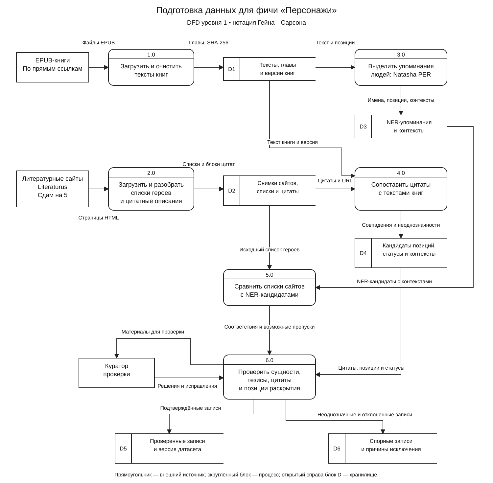

# Персонажи в «Интуиции»

**Контекст.** «Интуиция» — ИИ-приложение для чтения книг. По любому выделенному фрагменту оно даёт достоверный
ответ с опорой на отобранные экспертами источники. Сайт: [readintuition.ru](https://readintuition.ru).

# 1. Цели и предпосылки

## 1.1. Зачем идём в разработку продукта

**Проблема.** В больших художественных книгах много героев: у них бывают прозвища, их имена меняются, а читатель нередко делает паузы в чтении. В итоге он теряется и задаётся вопросами вроде «кто это?» или «кем он
приходится главному герою?». Чтобы разобраться, ему приходится листать книгу назад или искать ответ в
интернете, где легко нарваться на спойлеры. Согласно продуктовым исследованиям, часть читателей из-за этого бросает книгу.
Проблему подтверждают и конкуренты: в августе 2026 года Яндекс Книги запустили ИИ-функцию «О персонажах»
([новость](https://www.comss.ru/page.php?id=21562)), которая напоминает, кто есть кто, без раскрытия
непрочитанного. Раньше Яндекс выпустил «Ранее в книге» (ИИ-пересказ предыдущих глав после перерыва). По данным
компании, ею воспользовались более 13% подписчиков, а их время чтения выросло на 15%
([источник](https://rozetked.me/news/43271-funkciya-ranee-v-knige-ot-yandeksa-teper-dostupna-i-dlya-audioknig)).

**Как это решается сейчас.**

- Читатель сам листает книгу назад или ищет ответ в интернете, где рискует встретить спойлеры.
- В «Интуиции» чат отвечает по выделенному фрагменту и найденным фрагментам книги с опорой на источники (RAG).
  Списка героев, их характеристик и связей у приложения нет.
- Поэтому ответ на вопрос вроде «кем он ему приходится?» зависит от того, какие фрагменты попали в выдачу, а
  связь, разбросанная по разным главам, может потеряться.

Мы автоматизируем сбор знаний о героях: один раз заранее собираем их из книги и дальше отвечаем по готовым данным.
Сейчас не хватает именно этих данных и привязки каждого факта к месту в книге.

**Что делаем.** Добавляем в приложение «Интуиция» фичу «Персонажи». Читатель задаёт в чате вопрос
вроде «а кем Старцев ему приходится?» и получает точный ответ, который учитывает, до какого места он дочитал
(антиспойлер). Чтобы так отвечать, необходимо заранее автоматически собрать из книги всех персонажей и связи между
ними.

**Конкуренты.** Похожая фича уже есть у конкурентов (Яндекс Книги, Люмен). Функциональность разрабатывается для фичапаритета по базовым сценариям.
Отличия «Интуиции»:

- возможность задать вопрос в свободной форме в чате про героев и их связи;
- минимум спойлеров (меньше 2%);
- подтверждение цитатами каждого факта.

**Почему здесь нужен ML.**

- Вручную описывать героев для каждой книги библиотеки невозможно: это дорого и не
  масштабируется.
- Обычный поиск по тексту (RAG) тоже не подходит: связи между героями разбросаны по всей книге,
  и поиск находит отдельные фрагменты, но не собирает из них полную картину. Из-за этого ответ на вопрос о связи
  героев зависит от того, какие фрагменты попали в выдачу, и часть связей теряется.

**Что считаем успехом итерации.** Читатели пользуются вопросами и карточками про героев, ответы верны, доля спойлеров
меньше 2%, а подготовка новой книги проходит без ручной работы.

## 1.2. Бизнес-требования и ограничения

**Функциональные требования**

- Фича работает только для художественных книг.
- В чате можно спросить про героя («кто такой Старцев?») и про связь героев («кем Старцев ему приходится?»).
  Местоимения вроде «ему» система понимает из контекста диалога и места, где читатель находится в книге.
- Ответы учитывают позицию чтения: в них нет ничего из того, что читатель ещё не прочитал. Если он сам
  захочет, он может отключить антиспойлер. Тогда ответы должны учитывать все произведение.
- У каждого факта и каждой связи есть источник: цитата и глава, чтобы читатель мог проверить ответ.
- Читатель может открыть карточку героя (характеристики, факты, связи) и схему отношений. Они строятся из тех же
  данных, что и ответы в чате.
- Читатель может пожаловаться на ошибку в ответе или карточке.
- Новая книга обрабатывается автоматически. Куратор может выборочно проверить результат и исправить ошибки.

**Нефункциональные требования**

- *Качество.* Целевые показатели достоверности, подтверждения цитатами и доли спойлеров заданы в критериях
  успеха пилота ниже.
- *Скорость.* Ответ в чате приходит не позже чем за 5 секунд. Карточка и схема открываются без заметной
  задержки, так как данные собраны заранее.
- *Стоимость.* Обработка одной книги стоит не больше 1 000 ₽, один ответ в чате — не больше 3 ₽
  (первичная оценка по объёму книги около 1 млн токенов и цене облегчённой модели, уточним замерами).
- *Автоматизация.* Обработка книги запускается без ручных шагов, результат на одной и той же книге воспроизводим
  в пределах допуска по метрикам качества.
- *Масштабируемость.* Архитектура не должна мешать масштабированию на всю художественную библиотеку.
- *Юридические.* Тексты книг защищены авторским правом, поэтому в ответах показываем пересказ и короткие
  цитаты (не длиннее 30 слов, то есть одно-два предложения), а не крупные фрагменты.
- *Язык.* Книги и вопросы на русском языке.

**Ограничения**

- Бюджет пилота на языковые модели (обработка книг и ответы в чате) не больше 15 000 ₽.
- Используем готовые языковые модели, свои не обучаем.
- Работаем в рамках текущей инфраструктуры «Интуиции»: тексты книг и чат-ассистент на RAG уже есть.

**Ожидаемый результат итерации.** Фича работает на двух художественных книгах из библиотеки.

**Как фича встраивается в процесс на время пилота.** Она включена только для пилотных книг, а остальные
работают как раньше. Если ответ или карточка содержат ошибку, читатель может на неё пожаловаться.

**Критерии успеха пилота**

Продуктовые:

- доля читателей пилотных книг, задавших вопрос о героях, не ниже 10%;
- доля положительных оценок (по кнопкам оценки ответа) про персонажей не ниже 80%.

Качество:

- доля спойлеров меньше 2%;
- ответы достоверны не менее чем на 95%;
- не менее 80% фактов подтверждаются цитатой из книги.

Достоверность и спойлеры оцениваем на размеченной выборке не менее чем из 100 вопросов по двум пилотным
книгам: модель-судья сверяет ответ с текстом книги, часть ответов дополнительно проверяется вручную.

**Как измеряем и откуда пороги**

- Доля читателей, задавших вопрос о героях: число уникальных читателей пилотных книг, задавших в чате хотя бы
  один вопрос о герое или связи героев, делим на число читателей этих книг за период пилота. Данные берём из
  событий приложения.
- Положительные оценки: кнопки оценки ответа; жалобы на ошибки считаем отдельно.
- Достоверность, спойлеры и подтверждение цитатами: на размеченной выборке из 100 вопросов (см. выше).
- Откуда пороги. 10% читателей взято чуть ниже 13%, которые Яндекс сообщает для «Ранее в книге»: у нас новая
  фича и всего две книги. Остальные пороги (80% оценок, 95% достоверности, 2% спойлеров) выбраны экспертно и
  будут уточнены по замерам baseline.

**Дальнейшие шаги при успехе.** Раскатываем фичу на всю художественную библиотеку.

## 1.3. Что входит в скоуп, что не входит

**Входит в итерацию.** Минимальный набор возможностей для фичепаритета с Яндекс Книгами и Люменом.

- 2 книги (русская классика).
- Автоматический сбор персонажей, связей и фактов с привязкой к месту в книге.
- Ответы в чате про героев и их связи.
- Карточка героя.
- Схема отношений.
- Антиспойлер по позиции чтения.
- Проверка качества на двух книгах, размеченных вручную.

**Не входит в итерацию**

- Портреты персонажей.
- Другие жанры.
- Книги на других языках.
- Дообучение собственных моделей.
- Правки карточек самими читателями.
- Обсуждения героев.

## 1.4. Предпосылки решения

- В приложении «Интуиция» уже есть тексты книг, чат-ассистент на RAG. Позицию чтения каждого
  читателя мы знаем.
- Информацию о героях берём только из текста книги, а не из знаний модели. Иначе в ответы попадут спойлеры и сведения из экранизаций.
- Главные риски: ошибки в связях между героями, дубли одного героя под разными именами, утечка спойлеров и
  рост стоимости на очень длинных книгах.

## 1.5. Типичный use case

**Участники.** Читатель; приложение «Интуиция» (клиент); сервис «Персонажи» (серверная часть); база героев и
связей; языковая модель.

**Предусловия.** Книга уже обработана заранее. Читатель дошёл до главы 1 «Ионыча» А. П. Чехова, антиспойлер
включён. Приложение знает позицию чтения.

**Основной сценарий: вопрос в чате**

1. Читатель спрашивает в чате: «Кто такой Туркин?» и получает ответ, затем пишет: «А кем Старцев ему приходится?».
   Слово «ему» относится к Туркину из предыдущего вопроса.
2. Приложение отправляет сервису запрос с книгой, позицией чтения, режимом антиспойлера, историей диалога и
   вопросом (пример ниже).
3. Сервис определяет героев в вопросе (Старцев, Туркин), берёт из базы только данные до главы 1 и
   находит связь между ними.
4. Языковая модель формулирует ответ только по этим данным и приводит цитаты.
5. Приложение показывает ответ с цитатами и главами. Читатель может нажать на цитату и перейти к месту в
   книге, а также поставить оценку или пожаловаться на ошибку.

Запрос приложения к сервису (иллюстративно):

```json
{
  "book_id": "ionych",
  "position": {"chapter": 1, "offset": 5400},
  "antispoiler": true,
  "dialog": [{"role": "user", "text": "Кто такой Туркин?"}, {"role": "assistant", "text": "..."}],
  "question": "А кем Старцев ему приходится?"
}
```

Ответ сервиса:

```json
{
  "answer": "Старцев — гость в доме Туркиных: он приходит к ним в гости и знакомится с семьёй.",
  "sources": [{"quote": "...", "chapter": 1}],
  "characters": [{"id": "startsev", "name": "Старцев"}, {"id": "turkin", "name": "Туркин"}]
}
```

**Другие сценарии**

- *Карточка героя.* Читатель выделяет имя «Старцев» в тексте. Приложение запрашивает карточку героя
  с текущей позицией и получает характеристики, факты и связи только из прочитанного, каждый пункт с цитатой.
- *Схема отношений.* Приложение запрашивает связи героев до текущей позиции и рисует схему.
- *Антиспойлер выключен.* Читатель сам отключил его, и ответ учитывает всю книгу.
- *В прочитанном ответа нет.* Сервис отвечает, что по прочитанной части книги это пока неизвестно, и не
  раскрывает дальнейшее.
- *Ошибка в ответе.* Читатель жалуется на ответ, жалоба попадает куратору для проверки.

# 2. Методология

## 2.1. Постановка задачи

Это задача извлечения информации из длинного текста с учётом позиции в нём.

- **Вход:** текст книги, разбитый на главы.
- **Результат обработки книги:** список героев (с их прозвищами и вариантами имени) и связи между ними: кто
  кому кем приходится, цитата-подтверждение и место книги, начиная с которого читатель об этом узнаёт.
  Для каждого героя также сохраняем характеристики и факты в том же виде: формулировка, цитата-подтверждение
  и глава, в которой читатель об этом узнаёт. Характеристики описывают героя: внешность, характер, роль,
  изменения характера. Факты описывают то, что с героем происходит: поступки и события с его участием.
  По мере чтения набор характеристик и фактов героя растёт, и в ответе используются только те, что относятся
  к уже прочитанному.
- **Запрос читателя:** вопрос в чате или выделенный герой, позиция чтения. Ответ собирается только из
  данных, которые относятся к тексту до этой позиции при включённом антиспойлере.
- **Метрики качества:**
  - качество списка героев, который система собрала из книги, проверяем по эталонному списку, составленному
    вручную. Точность: какая доля найденных героев действительно есть в эталоне, то есть нет лишних и
    дублей (не ниже 90%). Полнота: какую долю героев из эталона система нашла, то есть нет пропущенных
    (не ниже 90%);
  - качество списка связей проверяем так же. Связь верна, если совпали оба героя и тип связи. Точность и
    полнота не ниже 70% (первичная цель, уточним по baseline);
  - качество характеристик героев проверяем по эталону, размеченному вручную для главных героев:
    - точность: доля найденных характеристик, которые верны и подтверждаются цитатой (не ниже 80%);
    - полнота: доля ключевых характеристик из эталона, которые система нашла (не ниже 60%, первичная цель);
    - привязка к главе: доля характеристик, отнесённых к той главе, где читатель впервые о них узнаёт
      (не ниже 90%). Это основа антиспойлера: ошибка здесь означает показ непрочитанного;
  - достоверность ответов, доля фактов с цитатой и доля спойлеров: см. критерии успеха пилота в 1.2.

## 2.2. Блок-схема решения

**Baseline.** Обычный RAG: по вопросу ищем фрагменты текста до позиции чтения и просим модель ответить.
Заранее собранных связей нет.


**MVP.** Книгу один раз обрабатываем заранее (А), а отвечаем уже по готовым данным (Б, В).


Сравнение проводится на двух уровнях:

| Уровень | Бейзлайн | Основное решение |
| --- | --- | --- |
| Подготовка сведений о героях | Списки и цитатные характеристики сайтов с привязкой к EPUB | Извлечение персонажей, фактов и связей из текста моделью |
| Ответы читателю | Существующий RAG по прочитанному тексту | Ответы по заранее извлечённым сведениям с подтверждениями |

Сайты задают исходное покрытие сведений, RAG задаёт качество существующего пользовательского сценария. Сравниваем затраты и качество на каждом уровне отдельно.

Функция «О персонажах» в Яндекс Книгах рассматривалась как конкурентный бейзлайн. На момент подготовки работы она временно отключена, поэтому провести сравнение на одинаковых книгах и позициях чтения невозможно.

## 2.3. Этапы решения задачи

Этапы опираются на [результаты EDA](../reports/eda/README.md): состав и объём данных, проверку цитат, покрытие героев характеристиками и поиск пропущенных лиц через NER. Числа из EDA относятся к зафиксированным EPUB; запланированные эксперименты ниже ещё не выполнены.

### Этап 1. Подготовка данных и разметки

**Вход.** EPUB [«Ионыча»](https://entitysearch-books.s3.yandex.net/176173.epub) и [ПиН](https://entitysearch-books.s3.yandex.net/139491.epub), внешние списки героев и цитатные характеристики. Источники сайтов: [Сдам на 5](https://www.sdamna5.ru/ionych_harakteristiki) и [Literaturus](https://www.literaturus.ru/2020/07/geroi-prestuplenie-i-nakazanie-opisanie-personazhi-spisok-tablica.html). Все страницы характеристик перечислены в [каталоге](../data/characters/profiles.csv).

Данные поступают при добавлении книги или обновлении её редакции и выбранных материалов. EPUB разбирается по OPF/spine, HTML сайтов по структуре записей и цитат. Исходные снимки, URL и SHA-256 сохраняются; результаты обработки записываются в CSV/JSON. Ежедневного обновления для пилота не требуется. Смена текста требует пересчёта позиций.



Схема показывает целевой процесс формирования датасета. Автоматические измерения выполнены; независимая проверка эталона ещё предстоит.

| Входные данные и признаки | Источник | Проверка |
| --- | --- | --- |
| Текст, порядок глав, символьные позиции | EPUB, [код разбора](../scripts/eda.py) | 5 и 41 литературная глава; хеши и объёмы зафиксированы |
| Имена, обращения и контексты | Текст EPUB, [NER](../scripts/ner_audit.py) | Сохранены все PER-упоминания, включая единичные; часть контекстов проверена |
| Списки героев и цитатные блоки | Литературные сайты, [сбор списков](../scripts/collect_characters.py), [каталог статей](../scripts/catalog_profiles.py) | Источники неполны; присутствуют ошибки глав и неоднозначные блоки |
| Вопрос, история и позиция чтения | Оценочные сценарии, позднее события пилота | Набор сценариев ещё предстоит подготовить |

Целевые сущности хранятся отдельно от входных данных:

| Сущность | Обязательные поля | Состояние |
| --- | --- | --- |
| Персонаж | book_version, entity_id, категория, имена и подтверждения | Есть исходные списки и модельная предразметка; полный человеческий эталон не готов |
| Упоминание | entity_id, chapter_id, start, end | Автоматические позиции NER сохранены; идентичность требует проверки |
| Характеристика или событие | entity_id, атомарный тезис, evidence, говорящий, модальность | Есть цитатные кандидаты; поддержка тезисов полностью не проверена |
| Связь | subject_id, predicate, object_id, evidence | Типы связей и эталон ещё предстоит разметить |
| Оценочный сценарий | scenario_id, family_id, позиция, история, вопрос, допустимый результат и запреты | Предстоит составить |

`evidence` содержит версию книги, главу и полуинтервал `[start, end)` в Unicode-символах очищенной главы. Для факта могут потребоваться несколько подтверждений. Отдельно сохраняются версия инструкции, статус разметки, происхождение записи и причина исключения. Порядок строки CSV не используется как постоянный идентификатор сущности.

**Проблемы, выявленные EDA.** Списки сайтов пропускают персонажей, материалы неодинаково покрывают героев. Найдены ошибочные указатели глав, различия написания имён между источниками и редакцией, ложные срабатывания NER. Автоматическое совпадение цитаты не подтверждает весь авторский тезис. Размеры глав различаются; в ПиН есть 12 абзацев длиннее 4 000 символов.

**Инструкция разметки.** До подготовки эталона фиксируются:

- категории лиц: участники повествования, только упомянутые, персонажи сновидений и внешние культурные отсылки;
- правила объединения имён и разрешения одноимённых героев;
- перечень типов направленных связей;
- правила разделения составного тезиса на факты;
- различие между утверждением повествователя, мнением героя и предположением;
- критерии поддержки тезиса цитатой и определения позиции раскрытия;
- статусы «подтверждено», «отклонено» и «недостаточно данных».

Сначала проводится небольшой пробный раунд разметки. Инструкция уточняется по расхождениям и получает версию. Часть заданий размечается двумя людьми независимо, до просмотра модельной предразметки. Исходные оценки сохраняются до обсуждения; разногласия разбираются отдельно. Для бинарных решений показываем долю совпадений и, если категории представлены достаточно, Cohen’s kappa с матрицей расхождений. Для свободных тезисов проверяем совпадение сущностей, содержания и evidence по инструкции. Согласие разметчиков само по себе не доказывает правильность.

**Достаточность и доразметка.** Двух текстов хватает для сравнения подходов на выбранных произведениях. Нужны полный аудит списков, независимый набор ключевых характеристик и связей, а также не менее 100 сценариев вопросов из первоначального плана. Числа «50 связей» и «40 характеристик» пока не считаются обоснованным размером эталона: объём определяется после пробной разметки и проверки покрытия.

**Плановый объём ближайшей разметки.** В исходные списки нужно добавить как минимум одно лицо «Ионыча» и 17 лиц ПиН с учётом персонажа сна. Это нижняя оценка по проверенным контекстам, а не полный объём пропусков. Все найденные лица получают категорию до включения в оценку. Для проверки инструкции первая партия содержит 20 сценариев, по 10 на книгу, с независимой разметкой двумя людьми. Эти примеры используются для разработки. Затем набор расширяется минимум до 100 сценариев, по 50 на книгу; тестовые семейства выделяются до подбора конфигурации. Количество характеристик и связей для полного эталона определяется по результатам пробного раунда с учётом покрытия, трудозатрат и расхождений. Пока точная оценка не получена, готовность этого этапа не заявляется.

Разметка включает случайно выбранные случаи и целевой отбор редких имён, спорных совпадений и потенциальных спойлеров. Источник отбора сохраняется. Инциденты помогают искать ошибки, но не оценивают их частоту в обычном потоке. Учитываем время разметки, повторной проверки и долю принятых записей. Стоимость пригодного примера включает отклонённые и переразмеченные задания.

В текущем наборе нет аккаунтов, диалогов и истории чтения пользователей. Обезличивание читательских данных для EDA не требуется. Для будущих логов исключаются токены и контактные данные, доступ к свободному тексту ограничивается. Для внешних источников фиксируются условия использования: доступность страницы не считается разрешением на публикацию её редакционных текстов. В репозитории сохраняются ссылки, метаданные и результаты анализа.

**Результат этапа.** Версионированный корпус, инструкция разметки, проверенные сущности и факты, оценочные сценарии, журнал спорных случаев и EDA. Сейчас готовы автоматические измерения и кандидаты; независимый человеческий эталон ещё не собран.

### Этап 2. Подготовка моделей и сравнение бейзлайнов

Используются готовые модели без дообучения. Подбираются модель, промпт, размер входного окна, перекрытие и способ объединения результатов.

**Бейзлайн подготовки сведений.** Статьи сайтов разбираются на героев, атомарные тезисы и подтверждения. Цитаты сопоставляются с EPUB. Неоднозначные записи получают статус для проверки. Работа по ручному разделению тезисов и исправлению записей учитывается отдельно. Отсутствующие в источнике эталонные сведения считаются пропусками при оценке полноты.

**Основное решение.** Модель получает окно книги и координаты. Возвращает JSON с персонажами, упоминаниями, фактами, связями и цитатами. Код проверяет формат и подтверждения; отдельный шаг объединяет повторные записи и алиасы. Natasha используется как дополнительный источник кандидатов, её PER-метки не принимаются автоматически за персонажей.

Оба подхода работают с одной редакцией текста и общей выходной схемой. Размер окон проверяется токенизатором модели. Преобразования, меняющие текст для поиска, сохраняют отображение в исходные координаты. Отдельные части книги не распределяются случайно между разработкой и тестом: связанные упоминания и факты зависимы.

#### Метрики и функции потерь

| Объект | Метрика и правило расчёта | Назначение |
| --- | --- | --- |
| Персонажи | Precision, recall, F1 после сопоставления с эталонными ID; дубли учитываются как лишние записи | Покрытие и точность списка |
| Алиасы | Precision и recall пар размеченных упоминаний одного лица | Ошибочные слияния и разделения |
| Связи | Precision, recall, F1; совпадают оба участника, тип и направление | Правильность отношений |
| Характеристики и события | Precision извлечённых атомарных тезисов, recall ключевых тезисов независимого эталона | Достоверность и полнота |
| Правильность цитирования | Поддержанные связки «тезис/цитата», делённые на все приведённые связки | Пригодность выбранных подтверждений |
| Полнота цитирования | Существенные утверждения с подходящим подтверждением, делённые на все существенные утверждения, требующие подтверждения | Пропущенные обоснования |
| Позиции | Верная глава и допустимая внутриглавная позиция; ранние и поздние ошибки отдельно | Риск спойлеров и задержка показа |
| Затраты | Время и стоимость обработки книги, число вызовов, повторы, ручная проверка | Стоимость получения пригодного результата |

Предварительные цели из постановки: precision и recall персонажей ≥90%; связей ≥70%; precision характеристик ≥80%, recall ключевых характеристик ≥60%; правильная первая глава раскрытия характеристики ≥90%. Они проверяются экспериментом и не описывают текущий результат. Пустые группы показываются как N/A с числом примеров.

Свои веса модели не обучаются, поэтому функция потерь для обучения не задаётся. Выбор конфигурации учитывает требования к подтверждениям и антиспойлеру, затем качество и затраты. Средний F1 не компенсирует критические нарушения. Лимит автоматической обработки составляет 1 000 ₽ на книгу; ручная работа учитывается отдельно.

#### Выборка и валидация

Для разработки используются примеры «Ионыча». После пробной разметки формируется отдельная выборка выбора конфигурации. Итоговая оценка проводится на заранее отложенных сценариях и эталонных записях ПиН. Разбиение и момент фиксации конфигурации сохраняются до просмотра итоговых оценок.

ПиН уже участвовал в EDA, поэтому он не объявляется полностью незнакомым произведением. EDA не используется для подбора по финальным метрикам. После просмотра теста изменения считаются новым циклом разработки и требуют новых закрытых примеров. Для проверки переноса на библиотеку потребуется третья книга.

Разбиение делается по семействам сценариев. Переформулировки, пограничные пары позиций и вопросы об одном исходном факте остаются вместе. Полный диалог не разделяется между частями. Доступ модели к тексту книги соответствует рабочему сценарию; эталонные карточки, ответы и тестовые метки в промпт не передаются. Промпты, примеры, пороги оценщика и правила слияния также подбираются только на части для разработки.

Оценочный сценарий включает цель читателя, книгу и версию, позицию, необходимую историю, вопрос, доступные факты, допустимые ответы или уточнения, обязательные подтверждения и запрещённые сведения. Оценивается решение задачи читателя, включая уточнение и отказ, а не совпадение с единственной формулировкой ответа.

Набор покрывает главных и эпизодических героев, алиасы, одноимённых лиц, отношения, мнения героев, составные подтверждения, отсутствие ответа в прочитанном и противоречивый контекст. Синтетические реплики строятся по заранее заданным фактам и ограничениям, затем проверяются. Варианты одного примера не считаются независимыми наблюдениями. После изменения позиции чтения правильное поведение выводится заново.

Размер теста определяется покрытием и требуемой точностью оценки, а не фиксированным процентом данных. Сто вопросов служат стартовым набором. Ноль спойлеров на ста независимых сценариях не подтверждает долю <2% с 95% уверенностью; нужны интервалы и расширение набора. Много перефразировок не заменяет новые независимые случаи.

#### Протокол сравнения

Сравнение парное: одинаковые примеры, редакция, позиции, лимиты контекста и сопоставимый бюджет. Для каждого примера сохраняются результаты всех решений и причины ошибок. Показываются итоговые метрики, размеры групп, разница с бейзлайном и интервалы неопределённости.

Для precision, recall и F1 применяется парный bootstrap с полным пересчётом метрики; зависимые примеры пересэмплируются семействами. Такие интервалы описывают выбранный набор сценариев, а не разнообразие всей библиотеки. Две книги недостаточны для устойчивой оценки неопределённости между произведениями.

Сначала сравнивается одна конфигурация на небольшом наборе для оценки бюджета. Затем по одному меняются модель, промпт, размер окна, перекрытие и контекст сущностей. Для выбранной конфигурации выполняются повторные прогоны. Если используется выбор из нескольких генераций, оценивается фактический алгоритм выбора с его затратами; наличие удачного ответа среди попыток не считается успехом системы само по себе.

#### Оценщик и интерпретация

Сначала выполняются программные проверки JSON, ссылок на сущности, цитат и координат. Смысловые свойства проверяются по рубрике. Если используется LLM-судья, его качество оценивается отдельно до принятия его решений как меток.

Набор аудита судьи включает правильные, ошибочные, пограничные и критические результаты разных конфигураций. Часть независимо оценивается людьми; настройка рубрики и закрытая проверка не смешиваются. Считаются пропуски ошибок, ложные тревоги и отказы судьи от решения. Для критических ошибок показывается отдельная полнота обнаружения. Проверяется аудит и принятых, и отклонённых результатов.

Судья получает тезис, вопрос при необходимости, позицию чтения и разрешённые подтверждения. Источники за пределами позиции не используются для оправдания ответа. Имена сравниваемых моделей скрываются. При парном оценивании проверяется перестановка A/B и B/A; отдельно измеряется нестабильность повторной оценки. После изменения модели судьи или рубрики аудит повторяется.

Для каждой ошибки сохраняются вход, предсказание, эталон и этап возникновения: извлечение, объединение, подтверждение, позиция или формат. Различаются ошибки модели и ограничения исходных материалов. Полный фактический запрос сохраняется вместе с порядком контекста и признаками усечения; одного шаблона промпта недостаточно для воспроизведения.

**Риски.** Ошибочная разметка, сведения из памяти модели, пропуск редких героев, ошибочное слияние, различия редакций, подбор на тесте, ошибки оценщика и нестабильность повторов. Снижение рисков обеспечивают независимый аудит, подтверждения из фиксированного текста, группировка сценариев, закрытая проверка и учёт повторов в бюджете.

**Результат этапа.** Проверенная методика оценки, сравнение решений с ошибками и затратами, выбранная конфигурация либо зафиксированный отказ от её использования при недостижении требований. Метрики моделей пока не измерены.

### Этап 3. Извлечение и хранение сведений

**Вход:** выбранная конфигурация, версия книги, схема сущностей и инструкция разметки.

В бейзлайне в общую схему приводятся проверенные материалы сайтов. В основном решении книга обрабатывается окнами; записи из перекрытий объединяются с сохранением подтверждений и происхождения. Полная книга должна обрабатываться без ручной подготовки характеристик; выборочный аудит качества учитывается отдельно.

Каждая запись связана с версией текста и evidence. Не допускаются потерянные ссылки на героев, дубли из повторного запуска и координаты другой редакции. Повторная обработка одной версии не должна создавать новые копии тех же записей. Исправления и исключения сохраняются в истории.

Проверяются структурная целостность, повторный запуск, частично обработанная книга, отсутствие цитаты и смена редакции. Исходные снимки, кандидаты, подтверждённые и спорные записи хранятся раздельно. Индекс, если он используется, связан с версией корпуса.

**Риски:** потери на границах окон, неверные слияния и устаревшие позиции. Качество проверяется по размеченным срезам, структурные инварианты программно.

**Результат:** воспроизводимая обработка книги и версионированный слой героев, характеристик, событий и связей с явными статусами.

### Этап 4. Чат и антиспойлер

**Вход:** вопрос, история, позиция чтения, режим антиспойлера и слой фактов.

Существующий RAG ищет фрагменты до позиции чтения. Основное решение выбирает доступные сведения о персонажах, затем формулирует ответ. Оба подхода оцениваются на одинаковых сценариях. При неоднозначном герое допустимо уточнение; при отсутствии подтверждения в прочитанном допустим отказ без раскрытия будущего.

Факт становится доступен после всех необходимых подтверждений. Учитываются доступность алиасов и выводов, а не только рёбер графа. Отбор выполняется кодом до передачи контекста модели. Из истории, результатов поиска, повторного ранжирования, памяти и кэша не должны поступать сведения, запрещённые текущей позицией. Отключение антиспойлера задаётся явно.

Проверяются позиции до, на и после границы раскрытия; возврат к ранней позиции; новый диалог; переключение режима; поздний алиас; несколько подтверждений; будущие сведения в истории; отказы и неоднозначность. В длинном контексте проверяется потеря существенного условия в начале, середине и конце, наличие отвлекающих фрагментов и усечение.

Ошибки локализуются по цепочке: нужное подтверждение есть в доступном корпусе → найдено → включено в контекст → правильно использовано → приведена подходящая ссылка. Для поиска считается recall нужных подтверждений при зафиксированном бюджете top-k. Для отделения ошибки поиска от ошибки ответа выполняется диагностический прогон с заранее правильным контекстом.

Для ответов считаются достоверность, полнота обязательных сведений, правильность и полнота цитирования, корректность уточнений и отказов. Спойлер считается на уровне сценария: хотя бы одно раскрытие будущего делает сценарий нарушенным, даже если следующие реплики верны. Все знаменатели фиксируются до запуска.

Цели из требований: достоверные ответы ≥95%, факты с подтверждениями ≥80%, спойлеры <2%, ответ ≤5 секунд, стоимость ≤3 ₽. Для времени дополнительно показываются p50, p95 и доля превышений; число ошибок и интервалы сопровождают показатели качества.

Проверяются недоступность модели, таймаут, обрезанный ответ и отсутствие части данных. Правила повторов, остановки и допустимого ответа задаются до испытаний. Повторы учитываются во времени и стоимости.

**Результат:** отчёт сравнения с существующим RAG, протокол антиспойлер-проверок и ответы с проверяемыми подтверждениями. Обнаруженные критические утечки устраняются до пилота.

### Этап 5. Карточка героя и схема отношений

**Вход:** та же доступная по позиции проекция фактов, что используется в чате.

Бейзлайн карточки использует материалы сайтов; основной вариант автоматически извлечённые сведения. Существующий RAG остаётся бейзлайном только для чата: готовых карточек и графа у него нет.

Карточка показывает доступные имена, характеристики, события и связи. Граф строится из доступных сущностей и отношений. Будущие имена и подписи узлов скрываются вместе с фактами. Каждое показываемое сведение имеет подтверждение и переход к позиции в книге.

Проверяется согласованность чата, карточки и графа для одинаковых позиций, переход к цитате, смена редакции, возвращение назад и отключение антиспойлера. Кэш учитывает книгу и её версию, доступную позицию и режим. Совпадение текста вопроса не считается достаточным ключом кэша.

**Риски:** расхождение представлений, будущие подписи и устаревший кэш. Проверки выполняются по общим сценариям и единому слою фактов.

**Результат:** карточки и граф двух книг, согласованные с чатом и проверенные на границах раскрытия.

### Этап 6. Подготовка и оценка пилота

**Вход:** результаты предыдущих этапов и зафиксированная конфигурация.

Перед запуском проверяется полный сценарий: вопрос о герое, уточнение связи, открытие карточки, переход к цитате, возвращение к чтению и жалоба на ошибку. Оценивается выполнение задачи читателя, весь использованный бюджет и нарушения по ходу сценария.

Проверки разделяются по частоте и цене: при изменении кода выполняются структурные проверки и инварианты; перед объединением изменений быстрые регрессии; перед пилотом полный набор, повторы и независимый аудит. После запуска сохраняется случайный аудит и разбор жалоб.

Продуктовые цели из первого этапа: вопросы о героях задают не менее 10% читателей пилотных книг, доля положительных оценок ответов не ниже 80%. Для каждого показателя фиксируются окно наблюдения, события и знаменатель. Отсутствие оценки, выход из диалога и переход по ссылке не считаются успешным исходом автоматически. Пользовательская оценка не заменяет проверку фактов.

Решение о пилоте учитывает качество, ошибки, стоимость автоматической обработки и трудозатраты. Успех на двух книгах не означает готовность всей библиотеки: перед расширением нужна проверка на новом произведении.

**Результат:** решение о запуске, ограничения пилота, воспроизводимая конфигурация и порядок обработки ошибок. Текущие EDA-результаты не считаются результатами пилота.
