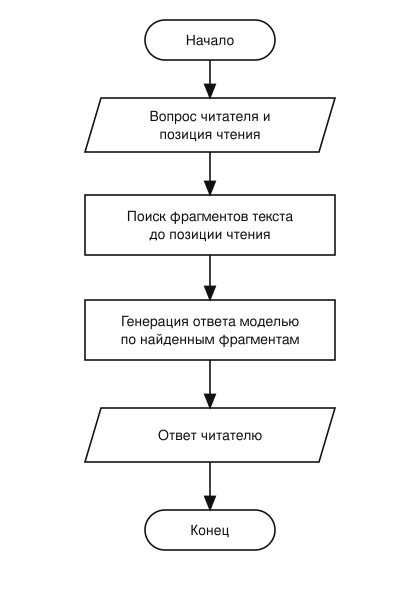
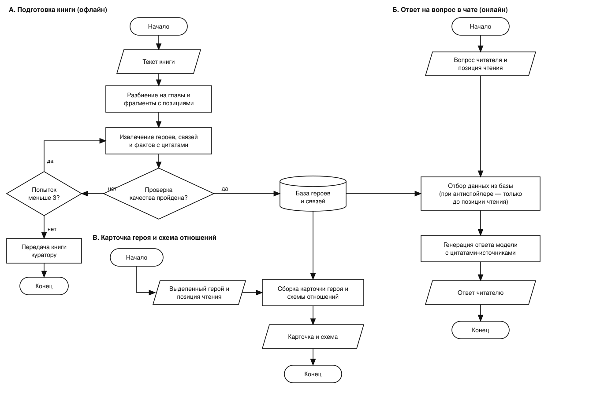

# Персонажи в Интуиции

**Контекст.** Интуиция — ИИ-приложение для чтения книг. По любому выделенному фрагменту оно даёт достоверный
ответ с опорой на отобранные экспертами источники. Сайт: [readintuition.ru](https://readintuition.ru).

# 1. Цели и предпосылки

## 1.1. Зачем идём в разработку продукта

**Проблема.** В больших художественных книгах много героев: у них бывают прозвища, их имена меняются, а читатель нередко делает паузы в чтении. В итоге он теряется и задаётся вопросами вроде «кто это?» или «кем он
приходится главному герою?». Чтобы разобраться, ему приходится листать книгу назад или искать ответ в
интернете, где легко нарваться на спойлеры. Часть читателей из-за этого бросает книгу.

**Что делаем.** Добавляем в приложение «Интуиция» фичу «Персонажи». Читатель задаёт в чате вопрос
вроде «а кем Старцев ему приходится?» и получает точный ответ, который учитывает, до какого места он дочитал
(антиспойлер). Чтобы так отвечать, необходимо заранее автоматически собрать из книги всех персонажей и связи между
ними.

**Конкуренты.** Похожая фича уже есть у конкурентов (Яндекс Книги, Люмен). Функциональность разрабатывается для фичапаритета по базовым сценариям.
Отличия «Интуиции»:

- возможность задать вопрос в свободной форме в чате про героев и их связи;
- отсутствие спойлеров;
- подтверждение цитатами каждого факта.

**Почему здесь нужен ML.**

- Вручную описывать героев для каждой книги библиотеки невозможно: это дорого и не
  масштабируется.
- Обычный поиск по тексту (RAG) тоже не подходит: связи между героями разбросаны по всей книге,
  и поиск находит отдельные фрагменты, но не собирает из них полную картину. В базовой конфигурации такой подход также не учитывает спойлеры.

**Что считаем успехом итерации.** Читатели пользуются вопросами и карточками про героев, ответы верны и не
содержат спойлеров, а подготовка новой книги проходит без ручной работы.

## 1.2. Бизнес-требования и ограничения

**Функциональные требования**

- Фича работает только для художественных книг.
- В чате можно спросить про героя («кто такой Старцев?») и про связь героев («кем Старцев ему приходится?»).
  Местоимения вроде «ему» система понимает из контекста диалога и места, где читатель находится в книге.
- Ответы учитывают позицию чтения: в них нет ничего из того, что читатель ещё не прочитал. Если он сам
  захочет, он может отключить автоспойлер. Тогда ответы должны учитывать все произведение.
- У каждого факта и каждой связи есть источник: цитата и глава, чтобы читатель мог проверить ответ.
- Читатель может открыть карточку героя (описание, факты, связи) и схему отношений. Они строятся из тех же
  данных, что и ответы в чате.
- Читатель может пожаловаться на ошибку в ответе или карточке.
- Новая книга обрабатывается автоматически. Куратор может выборочно проверить результат и исправить ошибки.

**Нефункциональные требования**

- *Качество.* Ответы достоверны не менее чем на 95%, не менее 80% фактов подтверждаются цитатой, спойлеров
  не больше 2%.
- *Скорость.* Ответ в чате приходит не позже чем за 5 секунд. Карточка и схема открываются без заметной
  задержки, так как данные собраны заранее.
- *Стоимость.* Обработка одной книги стоит не больше 1 000 ₽, один ответ в чате — не больше 3 ₽
  (первичная оценка по объёму книги около 1 млн токенов и цене облегчённой модели, уточним замерами).
- *Автоматизация.* Обработка книги запускается без ручных шагов и на одной и той же книге даёт
  одинаковый результат.
- *Масштабируемость.* Подход должен работать на всей художественной библиотеке, а не только на пилотных книгах.
- *Юридические.* Тексты книг защищены авторским правом, поэтому в ответах показываем пересказ и короткие
  цитаты (не длиннее 30 слов, то есть одно-два предложения), а не крупные фрагменты.
- *Язык.* Книги и вопросы на русском языке.

**Ограничения**

- Бюджет пилота на языковые модели (обработка книг и ответы в чате) не больше 15 000 ₽.
- Используем готовые языковые модели, свои не обучаем.
- Работаем в рамках текущей инфраструктуры Интуиции: тексты книг и чат-ассистент на RAG уже есть.

**Ожидаемый результат итерации.** Фича работает на нескольких художественных книгах из библиотеки.

**Как фича встраивается в процесс на время пилота.** Она включена только для пилотных книг, а остальные
работают как раньше. Если ответ или карточка содержат ошибку, читатель может на неё пожаловаться.

**Критерии успеха пилота**

Продуктовые:

- доля читающих, задавших вопрос о героях, не ниже 30%;
- доля положительных оценок ответов про персонажей не ниже 80%.

Качество:

- в проверочных наборах нет спойлеров;
- ответы достоверны на 95%;
- 80% фактов подтверждаются цитатой из книги.

**Дальнейшие шаги при успехе.** Раскатываем фичу на всю художественную библиотеку.

## 1.3. Что входит в скоуп, что не входит

**Входит в итерацию.** Минимальный набор возможностей для фичепаритета с Яндекс Книгами и Люменом.

- 2 книги (русская классика).
- Автоматический сбор персонажей, связей и фактов с привязкой к месту в книге.
- Ответы в чате про героев и их связи.
- Карточка героя.
- Схема отношений.
- Антиспойлер по позиции чтения.
- Проверка качества на нескольких книгах, размеченных вручную.

**Не входит в итерацию**

- Портреты персонажей.
- Другие жанры.
- Книги на других языках.
- Дообучение собственных моделей.
- Правки карточек самими читателями.
- Обсуждения героев.

## 1.4. Предпосылки решения

- В приложении Интуиция уже есть тексты книг, чат-ассистент на RAG. Позицию чтения каждого
  читателя мы знаем.
- Информацию о героях берём только из текста книги, а не из знаний модели. Иначе в ответы попадут спойлеры и сведения из экранизаций.
- Используем готовые языковые модели и не обучаем свои.
- Главные риски: ошибки в связях между героями, дубли одного героя под разными именами, утечка спойлеров и
  рост стоимости на очень длинных книгах.

# 2. Методология

## 2.1. Постановка задачи

Это задача извлечения информации из длинного текста с учётом позиции в нём.

- **Вход:** текст книги, разбитый на главы.
- **Результат обработки книги:** список героев (с их прозвищами и вариантами имени) и связи между ними: кто
  кому кем приходится, цитата-подтверждение и место книги, начиная с которого читатель об этом узнаёт. Факты о
  героях сохраняются так же, с позицией.
- **Запрос читателя:** вопрос в чате или выделенный герой, позиция чтения. Ответ собирается только из
  данных, которые относятся к тексту до этой позиции при включённом антиспойлере.
- **Метрики качества:** точность и полнота найденных героев и связей на вручную размеченных книгах, доля фактов с подтверждающей цитатой, доля спойлеров (цель: ноль). Продуктовые метрики описаны в 1.2.

## 2.2. Блок-схема решения

**Baseline.** Обычный RAG: по вопросу ищем фрагменты текста до позиции чтения и просим модель ответить.
Заранее собранных связей нет.

**MVP.** Книгу один раз обрабатываем заранее (А), а отвечаем уже по готовым данным (Б, В).

## 2.3. Этапы решения задачи

1. **Данные и разметка.** Выбираем 2 художественные книги и вручную размечаем в
   них героев и связи.
2. **Baseline.** Замеряем качество обычного RAG на вопросах о героях и связях.
3. **Извлечение и хранение.** Собираем героев, связи и факты с позициями. Качество проверяем сверкой с
   разметкой, проверкой цитат и проверкой на спойлеры, а часть ответов оценивает модель-судья.
4. **Чат и антиспойлер.** Ответы в чате строим только из данных до позиции чтения.
5. **Карточка героя и схема отношений** на тех же данных.
6. **Пилот** на нескольких книгах, затем раскатка на библиотеку. Риски и открытые вопросы фиксируем по ходу.
