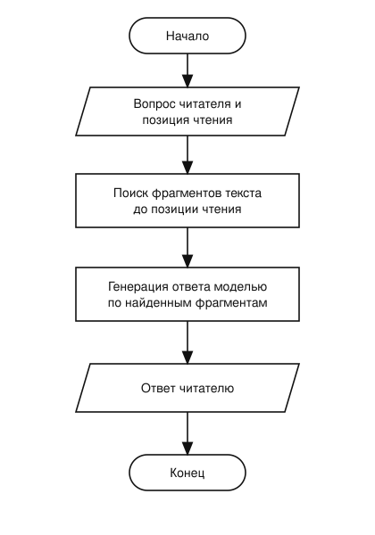
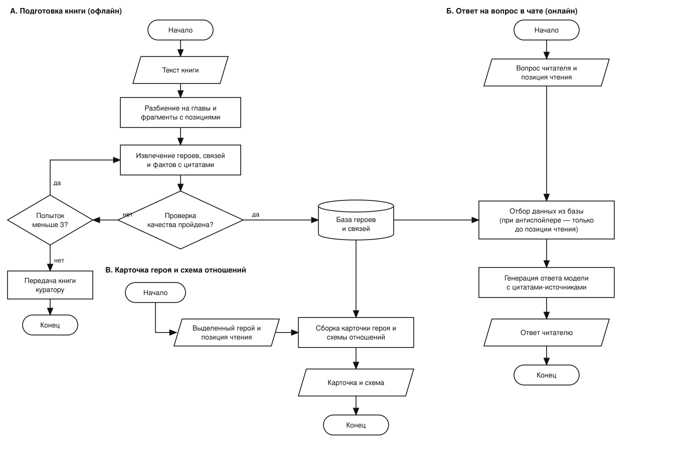

# Персонажи в «Интуиции»

**Контекст.** «Интуиция» — ИИ-приложение для чтения книг. По любому выделенному фрагменту оно даёт достоверный
ответ с опорой на отобранные экспертами источники. Сайт: [readintuition.ru](https://readintuition.ru).

# 1. Цели и предпосылки

## 1.1. Зачем идём в разработку продукта

**Проблема.** В больших художественных книгах много героев: у них бывают прозвища, их имена меняются, а читатель нередко делает паузы в чтении. В итоге он теряется и задаётся вопросами вроде «кто это?» или «кем он
приходится главному герою?». Чтобы разобраться, ему приходится листать книгу назад или искать ответ в
интернете, где легко нарваться на спойлеры. Согласно продуктовым исследованиям, часть читателей из-за этого бросает книгу.
Проблему подтверждают и конкуренты: в августе 2026 года Яндекс Книги запустили ИИ-функцию «О персонажах»
([новость](https://www.comss.ru/page.php?id=21562)), которая напоминает, кто есть кто, без раскрытия
непрочитанного. Раньше Яндекс выпустил «Ранее в книге» (ИИ-пересказ предыдущих глав после перерыва). По данным
компании, ею воспользовались более 13% подписчиков, а их время чтения выросло на 15%
([источник](https://rozetked.me/news/43271-funkciya-ranee-v-knige-ot-yandeksa-teper-dostupna-i-dlya-audioknig)).

**Как это решается сейчас.**

- Читатель сам листает книгу назад или ищет ответ в интернете, где рискует встретить спойлеры.
- В «Интуиции» чат отвечает по выделенному фрагменту и найденным фрагментам книги с опорой на источники (RAG).
  Списка героев, их характеристик и связей у приложения нет.
- Поэтому ответ на вопрос вроде «кем он ему приходится?» зависит от того, какие фрагменты попали в выдачу, а
  связь, разбросанная по разным главам, может потеряться.

Мы автоматизируем сбор знаний о героях: один раз заранее собираем их из книги и дальше отвечаем по готовым данным.
Сейчас не хватает именно этих данных и привязки каждого факта к месту в книге.

**Что делаем.** Добавляем в приложение «Интуиция» фичу «Персонажи». Читатель задаёт в чате вопрос
вроде «а кем Старцев ему приходится?» и получает точный ответ, который учитывает, до какого места он дочитал
(антиспойлер). Чтобы так отвечать, необходимо заранее автоматически собрать из книги всех персонажей и связи между
ними.

**Конкуренты.** Похожая фича уже есть у конкурентов (Яндекс Книги, Люмен). Функциональность разрабатывается для фичапаритета по базовым сценариям.
Отличия «Интуиции»:

- возможность задать вопрос в свободной форме в чате про героев и их связи;
- минимум спойлеров (меньше 2%);
- подтверждение цитатами каждого факта.

**Почему здесь нужен ML.**

- Вручную описывать героев для каждой книги библиотеки невозможно: это дорого и не
  масштабируется.
- Обычный поиск по тексту (RAG) тоже не подходит: связи между героями разбросаны по всей книге,
  и поиск находит отдельные фрагменты, но не собирает из них полную картину. Из-за этого ответ на вопрос о связи
  героев зависит от того, какие фрагменты попали в выдачу, и часть связей теряется.

**Что считаем успехом итерации.** Читатели пользуются вопросами и карточками про героев, ответы верны, доля спойлеров
меньше 2%, а подготовка новой книги проходит без ручной работы.

## 1.2. Бизнес-требования и ограничения

**Функциональные требования**

- Фича работает только для художественных книг.
- В чате можно спросить про героя («кто такой Старцев?») и про связь героев («кем Старцев ему приходится?»).
  Местоимения вроде «ему» система понимает из контекста диалога и места, где читатель находится в книге.
- Ответы учитывают позицию чтения: в них нет ничего из того, что читатель ещё не прочитал. Если он сам
  захочет, он может отключить антиспойлер. Тогда ответы должны учитывать все произведение.
- У каждого факта и каждой связи есть источник: цитата и глава, чтобы читатель мог проверить ответ.
- Читатель может открыть карточку героя (характеристики, факты, связи) и схему отношений. Они строятся из тех же
  данных, что и ответы в чате.
- Читатель может пожаловаться на ошибку в ответе или карточке.
- Новая книга обрабатывается автоматически. Куратор может выборочно проверить результат и исправить ошибки.

**Нефункциональные требования**

- *Качество.* Целевые показатели достоверности, подтверждения цитатами и доли спойлеров заданы в критериях
  успеха пилота ниже.
- *Скорость.* Ответ в чате приходит не позже чем за 5 секунд. Карточка и схема открываются без заметной
  задержки, так как данные собраны заранее.
- *Стоимость.* Обработка одной книги стоит не больше 1 000 ₽, один ответ в чате — не больше 3 ₽
  (первичная оценка по объёму книги около 1 млн токенов и цене облегчённой модели, уточним замерами).
- *Автоматизация.* Обработка книги запускается без ручных шагов, результат на одной и той же книге воспроизводим
  в пределах допуска по метрикам качества.
- *Масштабируемость.* Архитектура не должна мешать масштабированию на всю художественную библиотеку.
- *Юридические.* Тексты книг защищены авторским правом, поэтому в ответах показываем пересказ и короткие
  цитаты (не длиннее 30 слов, то есть одно-два предложения), а не крупные фрагменты.
- *Язык.* Книги и вопросы на русском языке.

**Ограничения**

- Бюджет пилота на языковые модели (обработка книг и ответы в чате) не больше 15 000 ₽.
- Используем готовые языковые модели, свои не обучаем.
- Работаем в рамках текущей инфраструктуры «Интуиции»: тексты книг и чат-ассистент на RAG уже есть.

**Ожидаемый результат итерации.** Фича работает на двух художественных книгах из библиотеки.

**Как фича встраивается в процесс на время пилота.** Она включена только для пилотных книг, а остальные
работают как раньше. Если ответ или карточка содержат ошибку, читатель может на неё пожаловаться.

**Критерии успеха пилота**

Продуктовые:

- доля читателей пилотных книг, задавших вопрос о героях, не ниже 10%;
- доля положительных оценок (по кнопкам оценки ответа) про персонажей не ниже 80%.

Качество:

- доля спойлеров меньше 2%;
- ответы достоверны не менее чем на 95%;
- не менее 80% фактов подтверждаются цитатой из книги.

Достоверность и спойлеры оцениваем на размеченной выборке не менее чем из 100 вопросов по двум пилотным
книгам: модель-судья сверяет ответ с текстом книги, часть ответов дополнительно проверяется вручную.

**Как измеряем и откуда пороги**

- Доля читателей, задавших вопрос о героях: число уникальных читателей пилотных книг, задавших в чате хотя бы
  один вопрос о герое или связи героев, делим на число читателей этих книг за период пилота. Данные берём из
  событий приложения.
- Положительные оценки: кнопки оценки ответа; жалобы на ошибки считаем отдельно.
- Достоверность, спойлеры и подтверждение цитатами: на размеченной выборке из 100 вопросов (см. выше).
- Откуда пороги. 10% читателей взято чуть ниже 13%, которые Яндекс сообщает для «Ранее в книге»: у нас новая
  фича и всего две книги. Остальные пороги (80% оценок, 95% достоверности, 2% спойлеров) выбраны экспертно и
  будут уточнены по замерам baseline.

**Дальнейшие шаги при успехе.** Раскатываем фичу на всю художественную библиотеку.

## 1.3. Что входит в скоуп, что не входит

**Входит в итерацию.** Минимальный набор возможностей для фичепаритета с Яндекс Книгами и Люменом.

- 2 книги (русская классика).
- Автоматический сбор персонажей, связей и фактов с привязкой к месту в книге.
- Ответы в чате про героев и их связи.
- Карточка героя.
- Схема отношений.
- Антиспойлер по позиции чтения.
- Проверка качества на двух книгах, размеченных вручную.

**Не входит в итерацию**

- Портреты персонажей.
- Другие жанры.
- Книги на других языках.
- Дообучение собственных моделей.
- Правки карточек самими читателями.
- Обсуждения героев.

## 1.4. Предпосылки решения

- В приложении «Интуиция» уже есть тексты книг, чат-ассистент на RAG. Позицию чтения каждого
  читателя мы знаем.
- Информацию о героях берём только из текста книги, а не из знаний модели. Иначе в ответы попадут спойлеры и сведения из экранизаций.
- Главные риски: ошибки в связях между героями, дубли одного героя под разными именами, утечка спойлеров и
  рост стоимости на очень длинных книгах.

## 1.5. Типичный use case

**Участники.** Читатель; приложение «Интуиция» (клиент); сервис «Персонажи» (серверная часть); база героев и
связей; языковая модель.

**Предусловия.** Книга уже обработана заранее. Читатель дошёл до главы 1 «Ионыча» А. П. Чехова, антиспойлер
включён. Приложение знает позицию чтения.

**Основной сценарий: вопрос в чате**

1. Читатель спрашивает в чате: «Кто такой Туркин?» и получает ответ, затем пишет: «А кем Старцев ему приходится?».
   Слово «ему» относится к Туркину из предыдущего вопроса.
2. Приложение отправляет сервису запрос с книгой, позицией чтения, режимом антиспойлера, историей диалога и
   вопросом (пример ниже).
3. Сервис определяет героев в вопросе (Старцев, Туркин), берёт из базы только данные до главы 1 и
   находит связь между ними.
4. Языковая модель формулирует ответ только по этим данным и приводит цитаты.
5. Приложение показывает ответ с цитатами и главами. Читатель может нажать на цитату и перейти к месту в
   книге, а также поставить оценку или пожаловаться на ошибку.

Запрос приложения к сервису (иллюстративно):

```json
{
  "book_id": "ionych",
  "position": {"chapter": 1, "offset": 5400},
  "antispoiler": true,
  "dialog": [{"role": "user", "text": "Кто такой Туркин?"}, {"role": "assistant", "text": "..."}],
  "question": "А кем Старцев ему приходится?"
}
```

Ответ сервиса:

```json
{
  "answer": "Старцев — гость в доме Туркиных: он приходит к ним в гости и знакомится с семьёй.",
  "sources": [{"quote": "...", "chapter": 1}],
  "characters": [{"id": "startsev", "name": "Старцев"}, {"id": "turkin", "name": "Туркин"}]
}
```

**Другие сценарии**

- *Карточка героя.* Читатель выделяет имя «Старцев» в тексте. Приложение запрашивает карточку героя
  с текущей позицией и получает характеристики, факты и связи только из прочитанного, каждый пункт с цитатой.
- *Схема отношений.* Приложение запрашивает связи героев до текущей позиции и рисует схему.
- *Антиспойлер выключен.* Читатель сам отключил его, и ответ учитывает всю книгу.
- *В прочитанном ответа нет.* Сервис отвечает, что по прочитанной части книги это пока неизвестно, и не
  раскрывает дальнейшее.
- *Ошибка в ответе.* Читатель жалуется на ответ, жалоба попадает куратору для проверки.

# 2. Методология

## 2.1. Постановка задачи

Это задача извлечения информации из длинного текста с учётом позиции в нём.

- **Вход:** текст книги, разбитый на главы.
- **Результат обработки книги:** список героев (с их прозвищами и вариантами имени) и связи между ними: кто
  кому кем приходится, цитата-подтверждение и место книги, начиная с которого читатель об этом узнаёт.
  Для каждого героя также сохраняем характеристики и факты в том же виде: формулировка, цитата-подтверждение
  и глава, в которой читатель об этом узнаёт. Характеристики описывают героя: внешность, характер, роль,
  изменения характера. Факты описывают то, что с героем происходит: поступки и события с его участием.
  По мере чтения набор характеристик и фактов героя растёт, и в ответе используются только те, что относятся
  к уже прочитанному.
- **Запрос читателя:** вопрос в чате или выделенный герой, позиция чтения. Ответ собирается только из
  данных, которые относятся к тексту до этой позиции при включённом антиспойлере.
- **Метрики качества:**
  - качество списка героев, который система собрала из книги, проверяем по эталонному списку, составленному
    вручную. Точность: какая доля найденных героев действительно есть в эталоне, то есть нет лишних и
    дублей (не ниже 90%). Полнота: какую долю героев из эталона система нашла, то есть нет пропущенных
    (не ниже 90%);
  - качество списка связей проверяем так же. Связь верна, если совпали оба героя и тип связи. Точность и
    полнота не ниже 70% (первичная цель, уточним по baseline);
  - качество характеристик героев проверяем по эталону, размеченному вручную для главных героев:
    - точность: доля найденных характеристик, которые верны и подтверждаются цитатой (не ниже 80%);
    - полнота: доля ключевых характеристик из эталона, которые система нашла (не ниже 60%, первичная цель);
    - привязка к главе: доля характеристик, отнесённых к той главе, где читатель впервые о них узнаёт
      (не ниже 90%). Это основа антиспойлера: ошибка здесь означает показ непрочитанного;
  - достоверность ответов, доля фактов с цитатой и доля спойлеров: см. критерии успеха пилота в 1.2.

## 2.2. Блок-схема решения

**Baseline.** Обычный RAG: по вопросу ищем фрагменты текста до позиции чтения и просим модель ответить.
Заранее собранных связей нет.



**MVP.** Книгу один раз обрабатываем заранее (А), а отвечаем уже по готовым данным (Б, В).



## 2.3. Этапы решения задачи

План опирается на [EDA двух книг](../reports/eda/README.md) от 01.11.2026.
Ниже отделены выполненные измерения данных от планируемых экспериментов с моделями.
Метрики из §1.2 и §2.1 остаются предварительными целями, а не достигнутыми результатами.

### Этап 1. Подготовка данных

**Вход.** «Ионыч» и «Преступление и наказание», публичные тексты с оглавлением.
В приложении тексты уже есть (§1.4), но в этом EDA использована публичная редакция,
а не выгрузка из продакшена. Перед интеграцией необходимо сверить редакции.

| Входные данные / признаки | Источник и доступность | Ресурс получения | Проверка качества |
| --- | --- | --- | --- |
| Текст и порядок глав | ilibrary.ru, скачаны обе книги | DS, скрипт EDA | 46 глав, хеши, строгая декодировка, выборочная проверка границ |
| Абзац, окно контекста, смещения | Производные от очищенного текста | DS/DE | Размеры измерены; перенос позиций в EPUB ещё не проверен |
| Имена, местоимения, реплики | Только текст доступного окна | DS | EDA форм имён; эталонной кореференции пока нет |
| Цитатные характеристики | Literaturus, проверена страница Старцева | DS + куратор | 26/27 цитатных блоков имеют единственную позицию-кандидат |
| Вопрос, история, позиция чтения | В пилоте — синтетические сценарии, затем приложение | DS + backend | Набор из 100 вопросов ещё предстоит составить |

Целевые сущности хранятся отдельно от входных признаков:

| Целевая переменная | Формат эталона | Наличие / ресурс | Проверка |
| --- | --- | --- | --- |
| Герой и алиасы | `book_id, entity_id, alias, revealed_at` | Проверенного gold нет; куратор | Полный список, омонимы, раздельные/слитые сущности |
| Направленная связь | `subject, predicate, object, evidence, revealed_at` | Цель ≥50 на две книги; куратор | Оба героя, тип, направление, контекст |
| Характеристика / факт | `entity_id, claim, evidence, speaker, modality, revealed_at` | Цель ≥40; куратор | Атомарность, цитата, мнение против факта |
| Ответ и допустимость показа | `question, position, answerable, reference, evidence` | Цель 100 вопросов; DS + куратор | Достоверность, цитирование, отсутствие будущего знания |

`evidence` содержит версию текста, главу и полуинтервал `[start, end)` в Unicode-символах.
`revealed_at` — место, к которому уже доступны все необходимые подтверждения, а не время события
в сюжете. Для составного вывода это наиболее поздняя из требуемых позиций. Алиасы и само
объединение двух имён тоже имеют момент раскрытия: глобальный словарь имён может выдать спойлер.

**Результаты EDA и решения.** В рассказе 33 760 символов, в романе 1 078 514;
в романе 13 абзацев длиннее 4 000 символов. Начальное окно обработки — до 4 000 символов
с перекрытием до 500, с разрезанием длинных абзацев по предложениям, а при необходимости по символам.
Это начальные параметры для эксперимента, их качество ещё не измерено. Каждый символ окна
отображается в исходную главу; дубликаты фактов из перекрытий объединяются по сущности и evidence.
Повторяющиеся реплики не удаляем. Местоимения и алиасы проверяем отдельно: 68,8% абзацев романа
начинаются с тире, поиск одной формы имени заведомо недостаточен.

**Генерация и обновление.** Источник → сохранение HTML и SHA-256 → очистка → главы/окна →
кандидаты фактов → проверка → версионированная витрина. Загрузка запускается при добавлении
книги или смене редакции, не ежедневно. Изменение текста инвалидирует позиции и требует
повторной обработки. Манифест публикуется в `reports/eda/`; сырой кэш остаётся локально.
В будущем импорт EPUB должен выдавать тот же контракт позиций, но его реализация в ДЗ №2 не входит.

**Бейзлайн данных B0.** По предложению владельца берём готовое описание героя в цитатах,
сопоставляем цитаты с книгой и собираем карточку. Реализован первый шаг на Старцеве:
26 из 27 цитатных блоков получили единственного кандидата (96,3%). Это не gold:
куратор проверяет соответствие тезиса цитате, контекст, говорящего, полноту и позицию раскрытия.
Неоднозначные/несопоставленные цитаты не публикуются автоматически. Статья служит источником
кандидатов и практическим ориентиром качества карточки; порядок её разделов не используется
как разметка глав. Для проверки recall независимо читаем книгу, включая отсутствующие в статье факты.

**Достаточность.** Обучения модели с нуля нет. Двух текстов хватает для прототипа, но нет
проверенной разметки. Собираем полные списки героев, целевые 50 связей, 40 характеристик и 100 вопросов.
Если после разметки редких связей мало, расширяем набор книг на следующей итерации;
до этого показываем объём каждого класса и не заявляем переносимость на библиотеку.

**Конфиденциальность.** В EDA нет пользовательских данных. Имена литературных героев не являются
идентификаторами читателей. Для будущих логов исключаем email, токены и идентификаторы аккаунтов,
псевдонимизируем сессии и ограничиваем доступ к свободному тексту диалога.
Редакционные описания внешнего сайта не копируем в публичный датасет: сохраняем ссылку,
хеши и результаты сопоставления; публикация корпуса описаний требует отдельного решения о правах.

**Выход и условие перехода.** Версионированные главы, отчёт EDA и кандидаты доступны сейчас.
Для сравнения моделей нужны проверенные целевые сущности, 100 вопросов и замороженные сплиты.
Куратор повторно проверяет все спорные случаи и минимум 20% остальных; расхождения разрешаются
до фиксации эталона. Текущие кандидаты нельзя выдавать за готовый проверенный датасет.

### Этап 2. Подготовка прогнозных моделей

В этой задаче «прогноз» — извлечение сущностей и генерация ответа, а не временной ряд.
Используем готовые модели без дообучения, как требует §1.2. Функцию обучения поставщика
не оптимизируем; для выбора конфигурации служат метрики на валидации и ограничения по стоимости.

| Решение | Бейзлайн | Основной MVP | Обоснование |
| --- | --- | --- | --- |
| Подготовка карточек | B0: внешнее цитатное описание → поиск позиций → проверка тезисов | LLM извлекает JSON из окон книги; объединение алиасов и фактов | B0 даёт ориентир на известных героях; MVP должен обрабатывать новую книгу без готовой статьи |
| Ответ в чате | B1: обычный RAG из §2.2, только текст до позиции | Поиск по доступным героям/связям, затем формулировка ответа LLM | Отделяем улучшение подготовки знаний от улучшения ответа |
| Предобработка | B0: нормализация цитат; B1: те же главы и фильтр позиции | Те же главы, окна, координаты; JSON-schema и проверка цитат | Единая редакция исключает скрытую разницу источников |
| Признаки | Текст цитаты или найденных фрагментов | Текст окна, локальные упоминания и доступный контекст | Нельзя подмешивать биографию или будущие факты из памяти модели |

B0 не является полностью автоматическим масштабируемым решением: зависит от наличия статей
и ручной проверки. Не сравниваем его затраты с MVP без учёта кураторского труда.
Для B0 измеряем покрытие героев/фактов и точность привязки; для B1 — качество ответов;
для MVP — обе группы метрик. Реализовано только сопоставление цитат B0, запусков LLM ещё нет.

**Валидация.** Единица оценки — герой/факт или вопрос с конкретной позицией.
Готовим по 50 вопросов на книгу: по 10 на идентичность/алиасы, связи, характеристики,
разрешение контекста диалога и случаи «в прочитанном ответа ещё нет».
В каждой группе включаем позиции до/после подтверждения и внутри главы.
Близкие переформулировки и пограничные пары относятся к одной группе и одному сплиту.
«Ионыч» используем для разработки; в романе выделяем 20 вопросов для валидации и 30
для закрытого теста. Тезисы и цитаты, использованные при настройке B0, не считаются закрытым тестом.
Тестовые ответы не раскрываем до фиксации промптов и параметров. Текст книги на инференсе доступен
по сценарию продукта; её эталонные карточки и ответы в промпт извлечения не передаём.
Для карточек MVP дополнительно считаем метрики по всему независимому эталону романа.
Двух книг недостаточно для надёжной оценки переноса между произведениями: следующая проверка —
новая книга, не использованная при разработке. Результаты всегда приводим отдельно по книгам и группам.

| Метрика / критерий | Расчёт и цель | Обоснование |
| --- | --- | --- |
| Герои | Precision и recall ≥90%; F1, TP/FP/FN после сопоставления ID | Штрафуем лишних, пропуски, ошибочные слияния и дубли |
| Связи | Precision/recall ≥70%; совпадают оба героя, тип и направление | Неверное направление меняет смысл ответа |
| Характеристики | Precision ≥80%, recall ключевых ≥60% | Ручная проверка атомарных тезисов, не совпадения слов |
| Позиция | Верная первая глава ≥90%; отдельно доля преждевременных позиций и ошибка в символах | Попадание в главу ещё не обеспечивает антиспойлер внутри неё |
| Ответы | Достоверных ≥95%; ответ верен, если верны все утверждения | Проверка по допустимому тексту, с ручным арбитражем |
| Подтверждения | ≥80% атомарных фактов поддержаны подходящей цитатой | Наличие похожего текста само по себе не доказательство |
| Спойлеры | Ответов с хотя бы одним будущим фактом <2% | Отдельно чат, карточки, граф; мнение судьи не заменяет проверку позиции |
| Отказ | Precision/recall отказов на неответимых запросах | Нельзя улучшить безопасность, отказываясь всегда |
| Время и стоимость | Доля ответов ≤5 с, p50/p95; ≤3 ₽/ответ, ≤1 000 ₽/книгу | Включаем поиск, LLM, повторы, объединение и проверку |

Для извлечения точность цитаты проверяется программно, поддержка тезиса — вручную.
Отсутствующая сущность/связь даёт FN, лишняя — FP; нулевые знаменатели показываем как N/A
с размерами групп. Публикуем micro и macro по книгам и число наблюдений.
Оценка <2% на малом тесте ненадёжна: даже 0/100 не доказывает этот порог с 95% уверенностью.
При нуле ошибок для односторонней верхней границы ниже 2% нужно минимум 149 независимых случаев;
похожие вопросы зависимы, поэтому расширяем набор книг и сценариев, а не только перефразируем.

**Функции потерь и выбор.** Дообучения нет, поэтому cross-entropy не используем как критерий
успеха. Выбор лексикографический: сначала отсутствие обнаруженных утечек и корректные evidence,
затем целевые precision/recall и достоверность, затем минимальная стоимость при приемлемом времени.
F1 диагностический, он не компенсирует нарушение антиспойлера.

**Развитие и интерпретация.** На валидации сравниваем 2 доступные готовые модели и 2 размера
окна (2 000/4 000 символов), фиксируем ID/версию модели, промпт, параметры, дату, токены и цены.
Сначала одна конфигурация на малом dev-наборе для оценки бюджета; расширяем эксперимент только
если суммарная оценка с резервом 20% укладывается в 15 000 ₽. Число вызовов и реальные токены
измеряем, не переводим символы в токены постоянным коэффициентом.
Приоритет улучшений: алиасы и кореференция, схема отношений, контроль цитат, повторы/слияния,
затем выбор модели. Абляция: одинаковая отвечающая модель и вопросы, с графом и без графа.
Для каждой ошибки сохраняем входное окно, этап, факт, позицию и причину; отчёт разделяет
ошибки извлечения, объединения, поиска, антиспойлера и формулировки ответа.

**Риски и выход.** Предобученная модель может помнить сюжет; контекст и требование evidence
снижают риск, но не исключают его — нужны adversarial-вопросы и ручная проверка.
Слияние разных героев разбираем по матрице ошибок алиасов; нестабильность API — повтором
финалиста на тех же вопросах. Выход этапа: таблица B0/B1/MVP с метриками, стоимостью,
ошибками и воспроизводимой конфигурацией. Если цели не достигнуты, фиксируем провал и пересмотр
решения, а не заявляем готовность пилота. Эти эксперименты запланированы, не выполнены в ДЗ №2.

### Этап 3. Позиционные факты и детерминированный антиспойлер

**Вход:** проверенные evidence и позиции из этапов 1–2, версия книги и позиция читателя.
B0 фильтрует подтверждённые тезисы карточки; B1 — текстовые фрагменты; MVP — факты,
связи, доступные имена и объединения сущностей **до** передачи в LLM.
Факт разрешён только после конца всех его подтверждений. Внутриглавный будущий текст
исключается; отключение антиспойлера — отдельная явная настройка.
Будущий контекст из истории диалога также нельзя передавать модели без проверки.

Проверяем позиции непосредственно до/на/после `evidence.end`, составные доказательства,
поздний алиас, изменение свойства и выключенный режим. Одни тесты применяем к B0/B1/MVP,
включая карточки и граф. Если факт не подтверждён или координаты другой версии, скрываем его.
Риск: отфильтрованный граф может раскрыть будущего героя подписью узла;
проверяем не только рёбра, но и имена/подписи. Выход — протокол проверок без обнаруженных утечек;
это условие пилота, а не математическая гарантия поведения LLM.

### Этап 4. Карточка, схема связей и подготовка пилота

**Вход:** позиционный слой и прошедшая оценку конфигурация.
B0 показывает проверенные тезисы литературной характеристики с цитатами; B1 остаётся чатом
без предвычисленных карточек; MVP собирает чат, карточку и граф из одной доступной проекции.
Для сопоставления интерфейсов используем одинаковых героев и позиции, включая отсутствие фактов.

Куратор проверяет переход к цитате, ограничения длины цитирования из §1.2,
обновление карточки при смене позиции, смену редакции и отсутствие будущих подписей.
Измеряем задержку отдельно для карточки и чата; суммы API-затрат включают переобработку книги.
Риски: расхождение трёх представлений, устаревший кэш и стоимость длинного романа.
Ключ кэша включает версию книги, позицию/доступный набор фактов, режим антиспойлера и версию модели.

Выход — две пилотные книги, отчёт качества и затрат, список ограничений и решение владельца
о запуске. После запуска отдельно считаем продуктовые метрики §1.2; offline EDA их не измеряет.
Раскатка на библиотеку возможна после проверки на новых книгах и разбора жалоб пилота.
