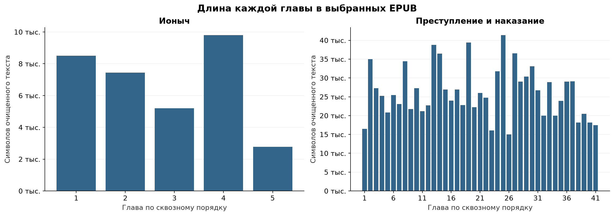
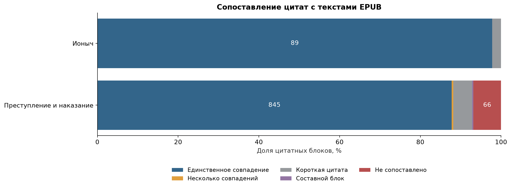
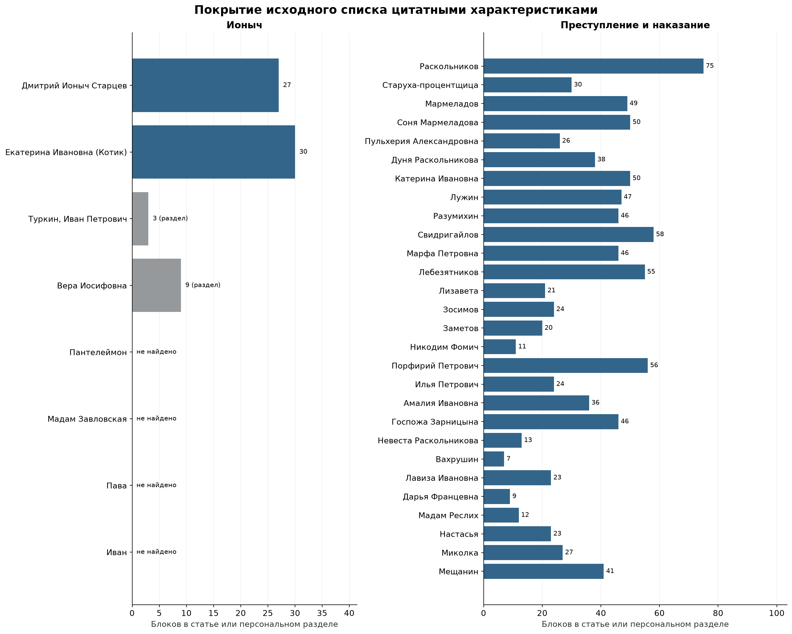
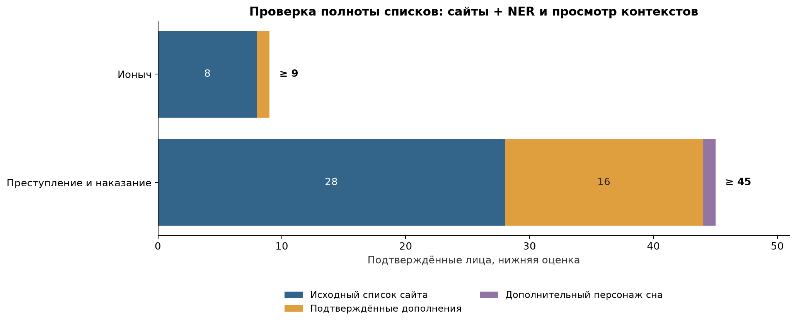

# EDA данных для фичи «Персонажи»

Срез: 1 ноября 2026 года. Анализ относится к двум конкретным EPUB, ссылки и SHA-256
которых зафиксированы в [манифесте источников](sources.json). Все показатели ниже пересчитаны
по этим файлам; прежние результаты на HTML другой библиотеки здесь не используются.

## 1. Состав данных

**Тексты произведений в EPUB.** Используем выбранные EPUB: [«Ионыч», 176173.epub](https://entitysearch-books.s3.yandex.net/176173.epub)
и [«Преступление и наказание», 139491.epub](https://entitysearch-books.s3.yandex.net/139491.epub).
Источник файла определяется прямой ссылкой; метаданные издания и адрес хостинга не подменяют друг друга.
Разбор EPUB, очистка и выделение глав: [scripts/eda.py](../../scripts/eda.py).
Параметры загрузки: [data/books.json](../../data/books.json).

**Внешние списки персонажей.** Для «Ионыча» используем [Сдам на 5](https://www.sdamna5.ru/ionych_harakteristiki),
для ПиН используем [таблица Literaturus](https://www.literaturus.ru/2020/07/geroi-prestuplenie-i-nakazanie-opisanie-personazhi-spisok-tablica.html).
Списки сохраняются в исходном порядке, с типом записи (человек/группа), URL и статусом проверки:
[ionych.csv](../../data/characters/ionych.csv), [crime.csv](../../data/characters/crime.csv).
Код сбора: [collect_characters.py](../../scripts/collect_characters.py).

**Цитатные характеристики.** Для «Ионыча»: [Старцев](https://www.literaturus.ru/2016/12/dmitrij-ionych-starcev-obraz-harakteristika-jetapy-zhizni.html),
[Екатерина Ивановна](https://www.literaturus.ru/2016/12/ekaterina-ivanovna-ionych-chehov-obraz-harakteristika.html),
[семья Туркиных](https://www.literaturus.ru/2016/12/semja-turkinyh-obraz-harakteristika-ionych.html).
Для всех 28 выбранных персонажей ПиН найдены отдельные статьи Literaturus.
Все конкретные ссылки и объёмы: [каталог profiles.csv](../../data/characters/profiles.csv).
URL, SHA-256 страниц и число блоков: [profile_sources.json](../../data/characters/profile_sources.json).
Код обхода ссылок и подсчёта: [catalog_profiles.py](../../scripts/catalog_profiles.py).

**Результаты NER.** Из очищенных глав EPUB Natasha извлекает PER-упоминания: исходную форму,
главу, символьные позиции и контекст. Код: [ner_audit.py](../../scripts/ner_audit.py),
все упоминания: [mentions.csv.gz](ner/mentions.csv.gz), ключи сравнения и частоты:
[candidates.csv](ner/candidates.csv). Использован тот же способ извлечения, что в
[NER-сервисе «Интуиции»](https://github.com/karpaff/intuition/blob/2d3ee3d4f1e8e86dc4c0bb09addf2449a5b8efdc/rag-backend/src/services/ner_service.py).
Для EDA отключены продовый порог частоты ≥2 и объединение через LLM: редкие имена сохраняются.

**Результаты сопоставления цитат.** Для каждого блока сохраняются URL статьи, номер блока,
хеш, статус и найденные позиции в книге. Код: [verify_profiles.py](../../scripts/verify_profiles.py),
нормализация: [quote_utils.py](../../scripts/quote_utils.py), результаты:
[profile_verification.json](profile_verification.json). Наличие цитаты и поддержка
авторской характеристики проверяются отдельно; семантика всех характеристик ещё не размечена.

## 2. Объём данных

| Данные | «Ионыч» | ПиН |
| --- | ---: | ---: |
| Литературные главы | 5 | 41 |
| Символы очищенного текста* | 33 700 | 1 074 046 |
| Абзацы после очистки | 163 | 3 770 |
| Персонажи в исходных списках сайтов** | 8 | 28 |
| Уникальные страницы с цитатными характеристиками | 3 | 28 |
| Цитатные HTML-блоки | 91 | 963 |
| Упоминания людей, выделенные Natasha | 177 | 4 571 |
| Различные нормализованные ключи NER (не люди) | 35 | 488 |
| Люди после ручной дедупликации проверенной части NER*** | ≥9 | ≥45 |

*Подсчёт и очистка.* EPUB открывается как ZIP; OPF/spine определяют порядок XHTML-файлов.
Обложка и файл примечаний исключаются. Внутри литературных файлов главы выделяются по
римским заголовкам, в том числе когда несколько глав находятся в одном XHTML.
Заголовки книги, частей и глав не включаются в объём литературного текста.
Извлекаются абзацы и стихотворные блоки, удаляются теги и ссылки-маркеры сносок;
XML-сущности декодируются, последовательности пробельных символов заменяются одним пробелом.
Абзацы соединяются двумя переводами строки. Символы считаются как Unicode code points (`len`),
включая эти разделители внутри главы; между главами разделители не добавляются.
Текст не исправляется по словарю, повторяющиеся реплики не удаляются. Исходные EPUB не меняются.
Детальные объёмы и хеши глав: [chapters.csv](chapters.csv).

**Восемь людей «Ионыча» и группа «Семья Туркиных» учитываются раздельно. Группа не считается
девятым человеком. Три страницы «Ионыча» включают общую статью о семье.

***Это нижняя оценка, не завершённая дедупликация всех NER-кандидатов. Формы имени
нормализованы для поиска, затем выбранные упоминания сопоставлены с людьми по контекстам.
Разные формы одного человека объединены; Миколка из сна отделён от маляра Николая.
В число включены только упомянутые в повествовании лица и персонаж сна; исторические
и литературные отсылки не добавлены как участники сюжета. Кураторской человеческой
разметки пока нет: контексты проверены с помощью модели, без независимого человеческого аудита.
Соответствия, контексты и координаты: [comparison_review.csv](ner/comparison_review.csv);
код воспроизведения зафиксированных решений: [compare_ner.py](../../scripts/compare_ner.py).

### 2.1. Распределение длины глав



**Вывод.** Главы «Ионыча» содержат от 2 780 до 9 793 символов,
Главы ПиН содержат от 14 999 до 41 344.
Роман в 31.9 раза длиннее рассказа. Обработку и стоимость нельзя оценивать
только на короткой книге. Главы различаются по размеру, поэтому граница главы не обеспечивает
постоянный размер входа. В ПиН 12 абзацев длиннее 4 000 символов:
разбиение только по абзацам также не ограничивает размер окна. Перед инференсом потребуется
проверка размера именно токенизатором выбранной модели; символы не равны токенам.

**Общий вывод по объёму.** Доступны два полных текста разного масштаба и материалы для
начала экспериментов. Объём цитатных блоков и число PER-упоминаний нельзя трактовать как
число уникальных фактов или героев. Двух произведений недостаточно для вывода о всей библиотеке.

## 3. Качество данных

### 3.1. Результаты проверки цитат



| Результат | «Ионыч» | ПиН |
| --- | ---: | ---: |
| Единственное совпадение | 89 | 845 |
| Несколько совпадений | 0 | 4 |
| Короткая цитата | 2 | 45 |
| Составной блок | 0 | 3 |
| Не сопоставлено | 0 | 66 |

**Вывод.** Для 934 из 1054 блоков (88.6%) найдено единственное место
после нормализации. Это кандидаты для автоматической привязки, не оценка правильности тезисов.
В 9 найденных блоках указатель части/главы сайта отличается от позиции в EPUB.
Для антиспойлера позицию определяем по книге, а не копируем из статьи.
Короткие блоки, составные цитаты и несколько совпадений требуют контекста и ручного разбора.
Несопоставленный блок не обязательно ошибочен: возможны другая редакция, сокращение,
вставка пояснения, маскировка слова или ограничение алгоритма.

**Метод проверки.** Регистр, ё/е, пробелы и пунктуация нормализуются. Служебная пометка
с главой или говорящим отделяется от цитаты. Фрагменты вокруг многоточий должны совпасть
в порядке внутри одной главы; допускается до 500 пропущенных нормализованных символов.
Если первый фрагмент короче 8 букв/цифр или их суммарно меньше 20, блок считается коротким.
Нечёткий поиск не используется. Все исходные смещения сохраняются; нормализация не меняет книгу.

### 3.2. Объём характеристик по персонажам



**Вывод.** Покрытие неравномерно. Для каждого из 28 выбранных персонажей ПиН найдена
отдельная цитатная статья; это ещё не охват всех персонажей романа.
У четырёх эпизодических героев «Ионыча» (Пантелеймона, мадам Завловской, Павы и Ивана)
готовые цитатные характеристики в проверенных источниках не найдены. Ноль на графике
означает отсутствие найденной статьи, а не отсутствие сведений о герое в книге.
Для Ивана Петровича и Веры Иосифовны показаны только персональные разделы общей статьи
о Туркиных: 3 и 9 блоков соответственно. Все 34 блока семейной статьи каждому не приписываются.
Объём страницы не равен полноте характеристик: несколько цитат могут подтверждать один тезис.

### 3.3. Полнота исходных списков



**Вывод.** Списки сайтов неполны. На EPUB обнаружены упоминания всех 8 и 28 лиц исходных
списков. Проверка контекстов дополнительно подтвердила Деметти в «Ионыче» и минимум
16 лиц ПиН: детей Катерины Ивановны, Капернаумова, Коха, Пестрякова, Душкина, Чебарова
и других. Отдельно учитывается Миколка из сна. Все подтверждения доступны в
[таблице сравнения](ner/comparison_review.csv). Полный разбор всех ключей NER не завершён,
поэтому график показывает нижнюю оценку пропусков, а не истинную полноту источника.
Если скоуп исключает только упомянутых людей и сновидения, соответствующие категории
нужно исключить и из эталона, и из оценки модели по одному правилу.

**Ограничения NER и дедупликации.** Модель ошибочно выделяет обычные слова, а словарная
нормализация может превратить фамилию в нарицательное слово или изменить род отчества.
Ключи сравнения не используются как канонические имена. Одно имя также может обозначать
разных людей. Продовый порог частоты ≥2 отсекает редкие упоминания, поэтому в EDA он снят.
Нашлось и различие формы имени между источником и редакцией: в списке сайта Дарья
Францевна, в выбранном EPUB указана Дарья Францовна. Сопоставление требует контекста, а не
строгого равенства строки.

### 3.4. Проверки текста и общий вывод

Число литературных глав проверено: 5 и 41. Служебные пункты и родительские узлы
оглавления не считаются отдельными главами. U+FFFD в очищенном тексте не обнаружен;
это не доказывает отсутствие опечаток. Повторные абзацы сохранены, поскольку повтор
реплики может быть авторским. Полная вычитка обеих редакций не выполнялась.

**Общий вывод.** Данные подходят для EDA и построения бейзлайна: доступны тексты,
начальные списки и цитаты, большую часть которых можно привязать автоматически.
При этом готового полного эталона нет. Основные риски: пропуск эпизодических героев,
неполные алиасы, ошибочные объединения, различия редакций и преждевременный показ
фактов при доверии указателям глав сайта. Для эталона нужны дополнение списков,
проверка связки «тезис/цитата» и фиксация правил включения лиц. Совпадение цитаты
не подтверждает интерпретацию, а найденные PER не доказывают полноту извлечения.

## 4. Воспроизведение и артефакты

Python 3.11; зависимости зафиксированы в [requirements-eda.txt](../../requirements-eda.txt).
Из корня репозитория:

```bash
python3.11 -m venv .venv-eda
.venv-eda/bin/pip install -r requirements-eda.txt
.venv-eda/bin/python scripts/eda.py
.venv-eda/bin/python scripts/collect_characters.py
.venv-eda/bin/python scripts/catalog_profiles.py
.venv-eda/bin/python scripts/verify_profiles.py
OPENBLAS_NUM_THREADS=1 OMP_NUM_THREADS=1 .venv-eda/bin/python scripts/ner_audit.py
.venv-eda/bin/python scripts/compare_ner.py
MPLCONFIGDIR=.matplotlib .venv-eda/bin/python scripts/eda_figures.py
.venv-eda/bin/python scripts/eda_report.py
```

Первый запуск скачивает EPUB и страницы источников. Сырой кэш и очищенные главы
хранятся в `data/raw/`, исключены из Git; публичные артефакты находятся в `data/characters/`
и `reports/eda/`. Повторный запуск использует кэш. Для нового снимка сохраните старый
кэш отдельно и запустите с пустой папкой: изменение SHA-256 требует пересчёта результатов.
Версии NER и хеши использованных глав: [ner/run.json](ner/run.json).
Код всех визуализаций: [eda_figures.py](../../scripts/eda_figures.py).
Ручные соответствия в `compare_ner.py` фиксируют решения после чтения контекстов
для этого снимка; на другой редакции их нужно проверить заново. Характеристики сайтов
как редакционные тексты целиком в репозитории не распространяются.

## 5. Разметка, достаточность и границы выводов

### 5.1. Какие результаты уже получены

| Результат | Состояние проверки |
| --- | --- |
| EPUB, порядок и объём глав | Автоматически разобраны оба файла; сохранены SHA-256 |
| PER-упоминания | Сохранены исходные формы, контексты и координаты; текст каждого упоминания проверен по полуинтервалу |
| Привязка цитат | Автоматическое сопоставление выполнено для всех 1 054 блоков |
| Дополнения к спискам | Выбранные контексты проверены с помощью модели; сохранены решения и подтверждения |
| Полный список уникальных персонажей | Не завершён; ≥9 и ≥45 остаются нижними оценками |
| Поддержка всех характеристик цитатами | Не размечена независимо; процент текстовых совпадений её не измеряет |
| Полный эталон связей и ключевых фактов | Не собран |
| Закрытая оценочная выборка сценариев | Не сформирована |
| Независимая человеческая проверка | Не проведена |
| Качество LLM-судьи | Не измерено |

Объём корпуса не равен покрытию задачи. Две книги, повторные упоминания одного лица и несколько цитат об одном свойстве не дают соответствующего числа независимых примеров. Вопросы разных формулировок об одном факте тоже зависимы. Из этого EDA нельзя вывести recall по всем героям, достоверность ответов или частоту спойлеров в пользовательском потоке.

### 5.2. Качество и происхождение предразметки

Материалы сайтов, результаты Natasha и сопоставление цитат используются как предразметка. Для эталона нужны инструкция, независимая проверка и разбор разногласий. Один источник может содержать сразу несколько видов ошибок: неполный список героев, верную цитату с неверной главой и неподтверждённую интерпретацию.

Проверка контекстов с помощью модели помогла найти пропуски исходных списков. Она не даёт независимой оценки правильности той же модели и не заменяет человеческий аудит. Текущие статусы и происхождение записей сохраняются; спорные случаи не объявляются ошибочными автоматически.

В инструкции следует определить состав персонажей, правила объединения имён, типы связей, атомарность фактов, говорящего, модальность и позицию раскрытия. Стабильные идентификаторы героев должны быть отделены от номеров строк источника. Версии инструкции и меток пока не зафиксированы: это необходимая следующая работа, а не результат EDA.

Для проверки качества нужны случайная часть предразметки и отдельный набор трудных случаев. В него входят редкие имена, одинаковые имена разных людей, неподтверждённые тезисы, короткие цитаты и конфликтующие указатели глав. Проверяется часть и принятых, и отклонённых записей. Отбор только удобных совпадений завысит качество.

### 5.3. Дисбаланс и пропуски

Неравномерность материалов видна на графике покрытия: главные герои описаны подробнее, а для части эпизодических лиц цитатные характеристики не найдены. Частые упоминания основных героев могут скрыть пропуски редких лиц в общей метрике. Поэтому будущая оценка должна показывать результаты по группам и размеры этих групп.

Пропущенная характеристика сайта не означает отсутствия свойства у героя. Пустая связь не означает, что герои не связаны. Такие записи нельзя автоматически превращать в отрицательные метки или дополнять знанием модели о сюжете.

Повторные абзацы встречаются 2 раза в «Ионыче» и 9 раз в ПиН сверх первых вхождений. Они сохранены как части литературного текста. Проверка близких дубликатов цитат и переформулированных фактов ещё не выполнена. Перед оценкой требуется связать повторы в семейства, сохранив исходные позиции и частоты.

### 5.4. План доразметки и оценочной выборки

Текстов достаточно для прототипа на выбранных книгах. Достаточность разметки для итоговой оценки пока не установлена. Следующие действия:

1. Утвердить правила включения персонажей и разделить участников сюжета, упомянутых лиц, сновидения и культурные отсылки.
2. Завершить проверку NER-кандидатов и объединение имён, сохраняя подтверждения и спорные решения.
3. Независимо разметить ключевые характеристики и связи по книге, чтобы оценка полноты не ограничивалась содержанием сайтов.
4. Провести пробную человеческую разметку, оценить расхождения и время на пригодный пример, затем уточнить инструкцию.
5. Сформировать сценарии с книгой, позицией, вопросом, историей, разрешёнными фактами, ожидаемым поведением и запретами. Семейства сценариев распределять целиком.

Приоритетный отбор трудных случаев используется вместе со случайной частью, а не вместо неё. Новые вопросы можно получать из подтверждённых фактов и сценариев, но сгенерированные реплики и ответы требуют проверки. Изменение позиции чтения может менять правильное поведение, поэтому старую метку нельзя переносить автоматически.

Первоначальные 100 вопросов служат стартовым планом. Размер окончательной проверки должен учитывать редкие сценарии и требуемую точность метрик. Ноль спойлеров на ста независимых случаях недостаточен для подтверждения порога <2% с 95% уверенностью. Перефразировки не увеличивают число независимых случаев.

Время разметки, стоимость человеческого аудита и доля принятых после проверки записей пока не измерялись. Обоснованного числа недостающих характеристик и связей нет. После пробного раунда оцениваются эти затраты и объём следующей партии. Произвольные числа не подменяют оценку покрытия.

### 5.5. Хранение и воспроизводимость

Исходные EPUB и HTML сохраняются отдельно от производных данных. URL и хеши находятся в манифестах, код и параметры в репозитории. Связь записи с файлом, версией книги и координатами проверяется до использования в оценке. Для нового корпуса требуется проверить применимость ручных соответствий заново.

В текущем наборе нет читательских аккаунтов, личных сообщений и истории чтения. Редакционные тексты сайтов целиком не публикуются; в репозитории сохраняются каталоги, метаданные и результаты проверок. Условия использования внешних материалов нужно фиксировать отдельно: доступность файла или страницы не определяет условия его повторной публикации.

### 5.6. Решение по результатам EDA

Внешние материалы принимаются как бейзлайн подготовки сведений и источник кандидатов для разметки. Их нельзя использовать как единственный эталон полноты. Независимое извлечение из EPUB уже выявило пропуски, а сопоставление цитат обнаружило ошибочные указатели глав.

Для следующего этапа готовы корпус, исходные списки, каталог характеристик, NER-упоминания, кандидаты позиций и код воспроизведения. Перед итоговым сравнением решений нужны инструкция разметки, независимый аудит, завершение дедупликации и закрытый набор сценариев. Выводы о качестве моделей, выполнении антиспойлерных требований и готовности пилота пока не делаются.
