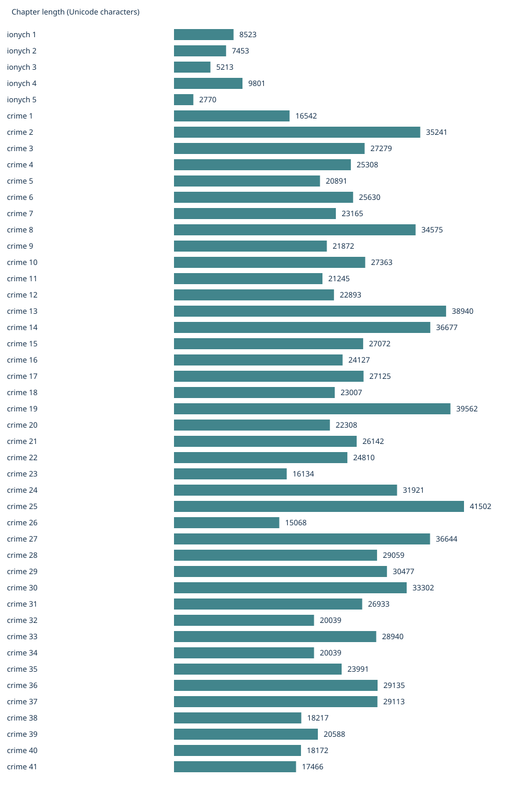
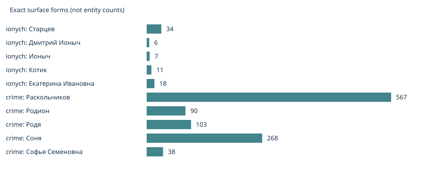

# EDA данных для фичи «Персонажи»

Срез: 1 ноября 2026 года. Анализ выполнен, модели ещё не запускались.
Книги выбраны владельцем: «Ионыч» и «Преступление и наказание».

## Источники и воспроизведение

- [Ионыч](https://ilibrary.ru/text/437/index.html): 5 глав.
- [Преступление и наказание](https://ilibrary.ru/text/69/index.html): 41 глава,
  включая две главы эпилога; `chapter_order` — сквозной порядок, не номер внутри части.
- [Цитатная характеристика Старцева](https://www.literaturus.ru/2016/12/dmitrij-ionych-starcev-obraz-harakteristika-jetapy-zhizni.html)
  — предложенный владельцем источник кандидатов для карточки и разметки.

Из корня репозитория, Python 3.11+, без сторонних библиотек:

```bash
python3 scripts/eda.py
python3 scripts/align_quotes.py
```

Первый запуск требует интернета. HTML кэшируется в `data/raw/` (не коммитится).
Повторный запуск использует кэш. Для обновления источников сначала сохраните старый кэш
и удалите его из этой папки; затем сравните SHA-256 с опубликованным манифестом.
[chapters.json](chapters.json) содержит URL и SHA-256 исходного HTML и очищенного текста каждой
главы; [summary.json](summary.json) — агрегаты; [run.json](run.json) — время расчёта.
Тексты и редакционные материалы сайта в репозитории не распространяются.

Очистка: строгая Windows-1251, только литературные блоки `<z>`, HTML entities,
удаление скриптов, маркеров и текстов сносок, схлопывание пробелов.
Вложенные стихотворные строки сохраняются внутри абзаца. Смещения считаются в Unicode-символах
очищенной главы, с двумя переводами строки между абзацами. Для EPUB приложения нужна отдельная
сверка редакции и таблица соответствия позиций; эти смещения туда переносить напрямую нельзя.
Вручную проверены начало и конец первой и последней главы обеих книг; это не полная вычитка.

## Состав, объём и качество

| Показатель | Ионыч | Преступление и наказание |
| --- | ---: | ---: |
| Главы | 5 | 41 |
| Символы, с разделителями внутри глав | 33 760 | 1 078 514 |
| Слова по кириллической регулярной маске | 5 365 | 169 750 |
| Абзацы | 162 | 3 760 |
| Абзацы, начинающиеся с тире | 63 (38,9%) | 2 588 (68,8%) |
| Абзацы длиннее 4 000 символов | 0 | 13 |
| Повторные вхождения одинаковых абзацев | 1 | 9 |
| Символ замены U+FFFD | 0 | 0 |
| Проверенные эталонные герои / связи / вопросы | 0 / 0 / 0 | 0 / 0 / 0 |

Полнота оглавления проверена по последовательности URL: пропусков нет. Ноль U+FFFD не доказывает
отсутствие опечаток, OCR-ошибок и отличий изданий. Повторы не удаляем: реплики могут повторяться
законно, а их позиции различаются. Подсчёт слов не равен токенизации языковой модели.



**Вывод.** Роман в 31,9 раза длиннее рассказа. Главы рассказа: 2 770–9 801 символ,
романа: 15 068–41 502. Нельзя оценивать бюджет и качество на одной короткой книге.
Нужны ограничение размера окна, перенос контекста между окнами и отдельный замер стоимости романа.
Разбиение только по абзацам не ограничивает размер входа из-за 13 длинных абзацев.



**Вывод.** Даже точный поиск даёт разные формы одного героя: Старцев — 34 вхождения,
Дмитрий Ионыч — 6, Ионыч — 7; Родион — 90, Родя — 103. Это выбранные заранее формы,
не результат NER и не число персонажей. Счётчики могут пересекаться: «Ионыч» входит в полное имя.
Поиск по одной форме пропускает упоминания; объединение алиасов требует контекста и времени раскрытия.
Высокая доля реплик в романе усиливает риск ошибок говорящего и местоименной кореференции.

## Эксперимент: цитатная характеристика → позиции

[quote_alignment.json](quote_alignment.json) фиксирует 27 блоков со страницы Старцева:
26 получили единственного кандидата, 1 не сопоставлен, неоднозначных кандидатов нет.
Это **96,3% покрытия автоматическим сопоставлением**, не точность карточек и не полнота фактов.

Алгоритм: извлечь `blockquote`, разделить пропуски по многоточиям, нормализовать NFKC,
регистр, ё/е, убрать пробелы и пунктуацию, найти все части по порядку в одной главе.
Каждый фрагмент должен иметь минимум 15 букв/цифр; суммарные пропуски ограничены 500 символами
нормализованного текста. Сохраняем исходные смещения, хеш цитаты и статус. Нечёткое сопоставление
не используется: отсутствие совпадения отправляет блок на ручную проверку.

Несопоставленный блок №3 содержит редакционное пояснение после цитаты. Кандидаты №23–24
находятся в главе 4, хотя статья группирует их в разделе более позднего периода жизни.
**Вывод.** Порядок статьи и биографическая хронология не заменяют позицию раскрытия в книге.
Найденный фрагмент подтверждает цитату, но не обязательно всю авторскую характеристику:
оценка героя другим персонажем не равна объективному свойству. Каждый тезис нужно отдельно
проверить по контексту, разделить составные тезисы и записать говорящего/модальность.

## Достаточность и ограничения

Текста достаточно для прототипа, но проверенного gold нет. Для следующего этапа нужны:
полные списки героев двух книг, минимум 50 связей и 40 характеристик (совокупно, целевой объём),
100 вопросов (50 на книгу) с позицией, допустимым ответом и подтверждением.
Если конкретный тип связи отсутствует, его не выдумываем: фиксируем фактический объём и сужаем выводы.
Часть кандидатов можно взять из цитатных характеристик, но для recall нужна независимая разметка
книги: статья выборочна и не является полным эталоном. По роману такое сопоставление ещё не выполнено.

Две книги не представляют всю библиотеку. Эти данные не позволяют измерить качество модели,
подтвердить бизнес-эффект или SLA. Читательские диалоги, аккаунты и продовые данные не использовались.
